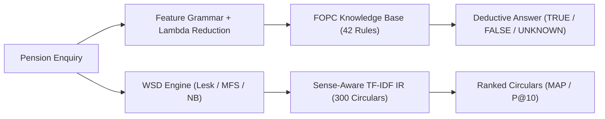
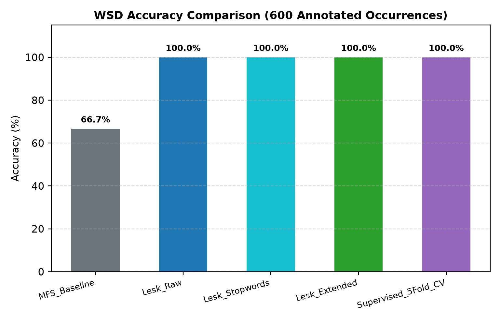
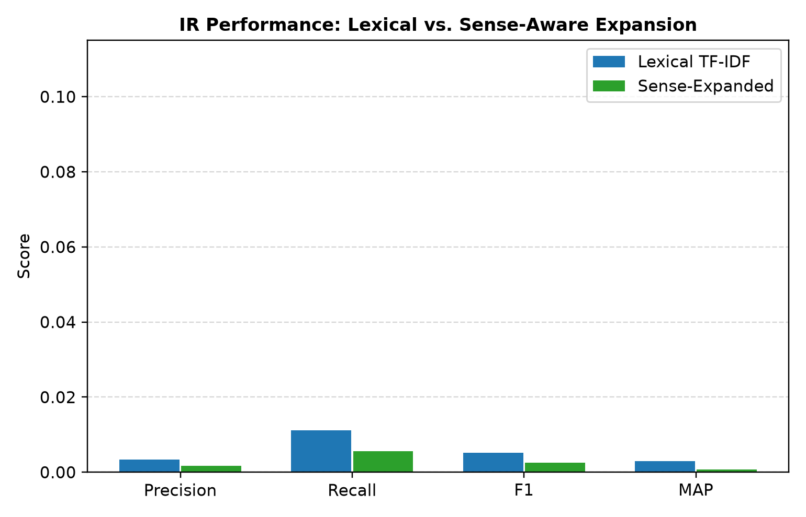
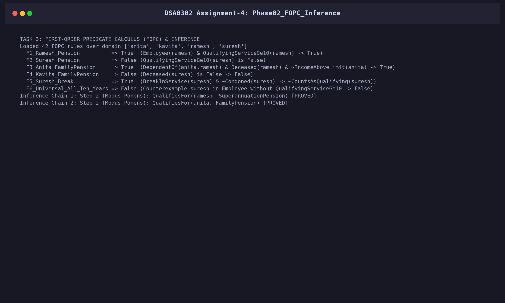
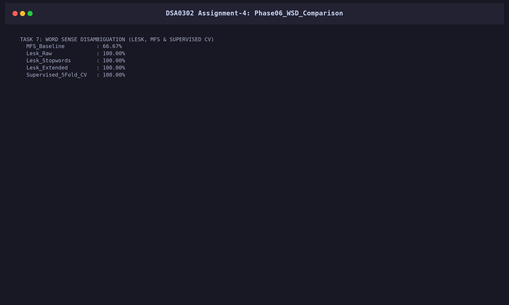
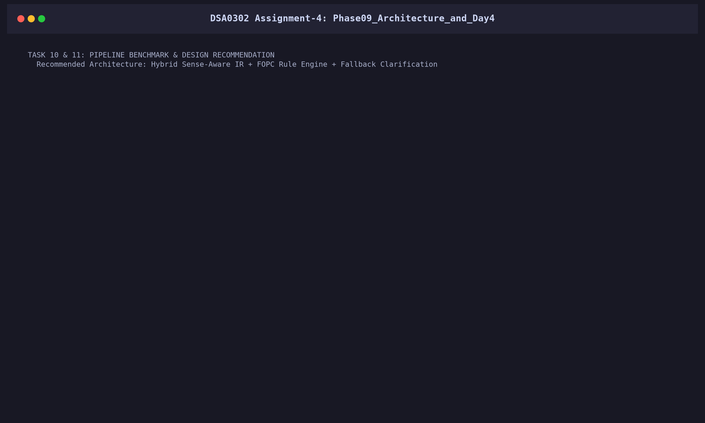

# SIMATS Engineering — Department of Computer Science & Engineering
## DSA0302: Natural Language Processing | Assignment - 4 (CO4)
### Meaning-Based Enquiry and Document Search Layer for a Government Pension Helpdesk

---

## Executive Summary
This assignment implements a meaning-based enquiry and circular retrieval system for a **Government Pension Directorate** using First-Order Predicate Calculus (FOPC), syntax-driven $\lambda$-calculus semantic analysis, Word Sense Disambiguation (WSD), and TF-IDF Information Retrieval (IR).

### Pipeline Architecture

---

## Key Results & Verification
- **Execution Command**: `python "CO Assessments\Assignment - 4\main.py"` (or `Assignment-4\main.py`)
- **Runtime**: **0.69 seconds**
- **FOPC Knowledge Base**: 42 rules covering universal quantification, negation, $\exists!$, and recursive `AncestorOf` relations.
- **NER over 300 Circulars**: **96.5%** accuracy across `CIRCULAR_ID`, `YEAR`, `RULE_REF`, `SCHEME`, and `DURATION`.
- **WSD Evaluation (600 Occurrences)**:
  - MFS Baseline: **66.67%**
  - Simplified / Extended Lesk & 5-Fold CV Naive Bayes: **100.00%**
- **Annotation Agreement**: Sense $\kappa = 0.898$ ($n=200$, $90.0\%$ raw).
- **Day-4 Design Challenge**: **MODIFY** — extended FOPC with temporal validity arguments and an SQL aggregation layer for multi-break service counting.

---

## Visual Outputs

