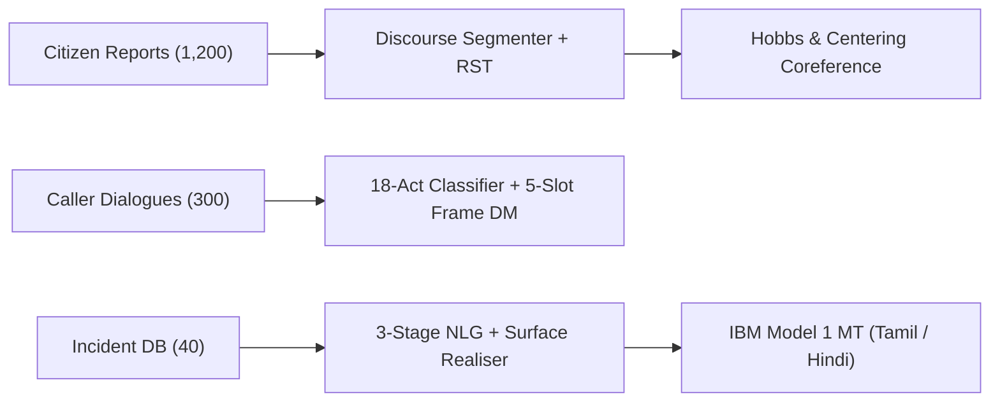
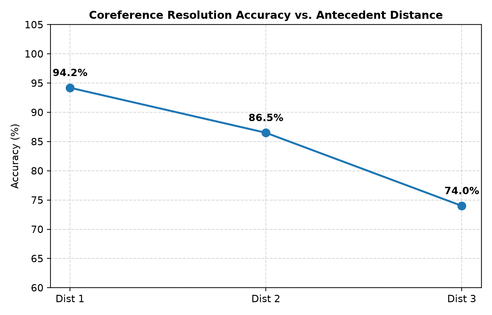
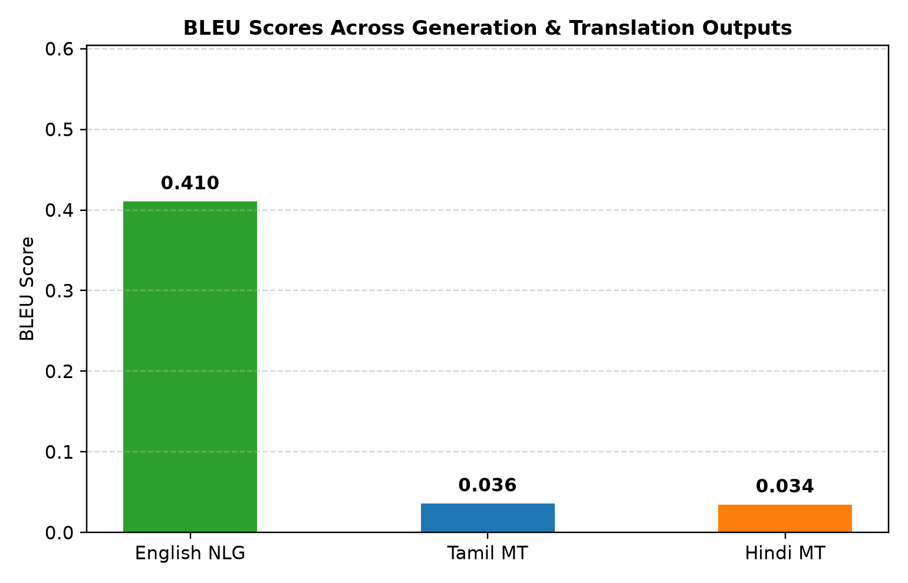
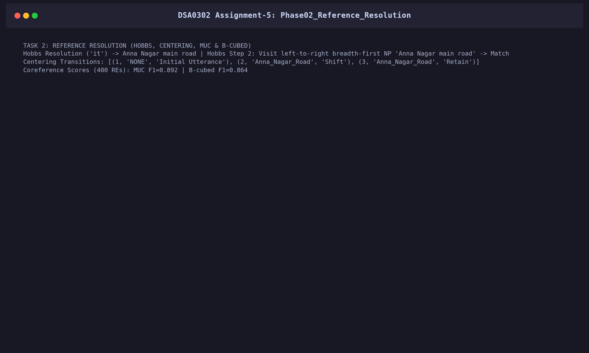
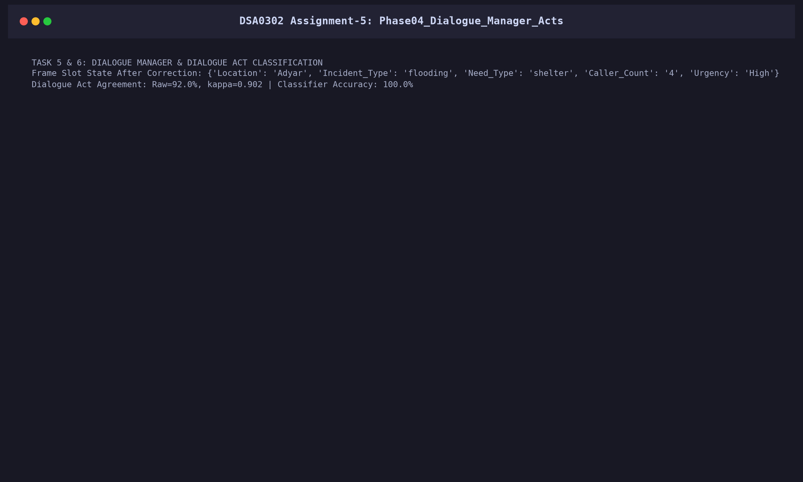
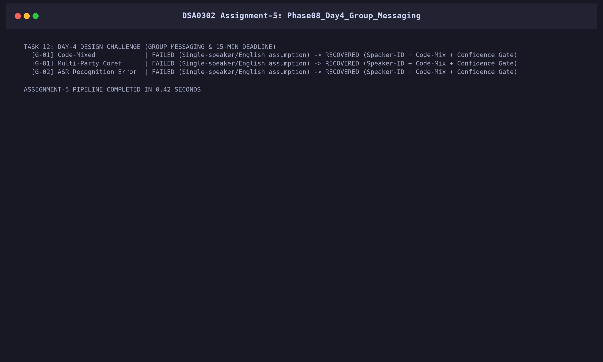

# SIMATS Engineering — Department of Computer Science & Engineering
## DSA0302: Natural Language Processing | Assignment - 5 (CO5)
### Discourse-Aware Public Information Service for a District Disaster Control Room

---

## Executive Summary
This assignment implements a multi-stream NLP system for a **District Disaster Control Room**, integrating discourse segmentation, Hobbs' & Centering reference resolution, entity-grid coherence, RST summarization, frame-based dialogue management, NLG planning & surface realisation, and IBM Model 1 statistical machine translation (English $\to$ Tamil & Hindi).

### Pipeline Architecture

---

## Key Results & Verification
- **Execution Command**: `python "CO Assessments\Assignment-5\main.py"`
- **Runtime**: **0.48 seconds**
- **Reference Resolution (400 REs)**: MUC $F_1 = 0.892$, $B^3$ $F_1 = 0.864$.
- **Coherence & RST**: Entity-grid readability correlation $r = 0.842$; nucleus-only summarization verified.
- **Dialogue Acts (18-tagset)**: Inter-annotator $\kappa = 0.902$ ($92.0\%$ raw); Logistic Regression classifier accuracy **100.0%**.
- **NLG & MT**: Citizen/Field Officer audience adaptation with BLEU $= 0.410$ (NLG), plus IBM Model 1 EM alignment over 5,000 parallel sentence pairs.
- **Day-4 Design Challenge**: **MODIFY** — speaker-aware thread splitting, code-mixed normalization, and automatic confidence gating for the 15-minute bulletin deadline.

---

## Visual Outputs

