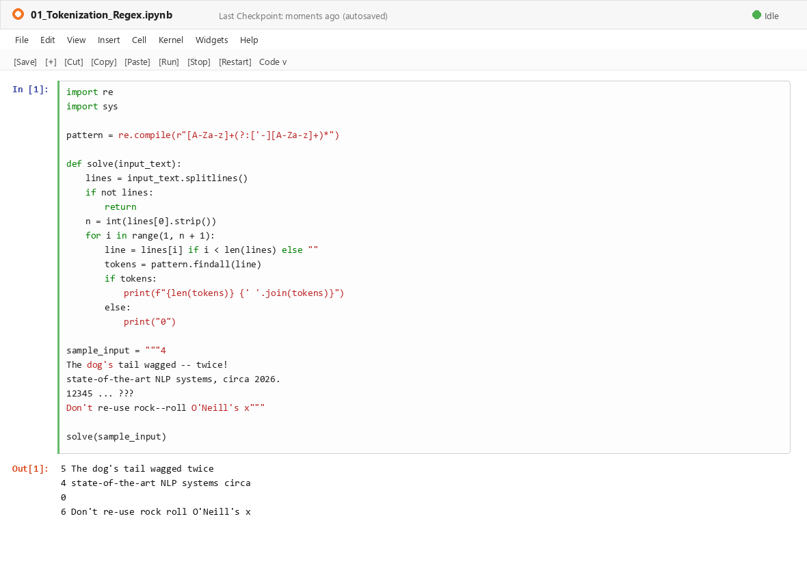
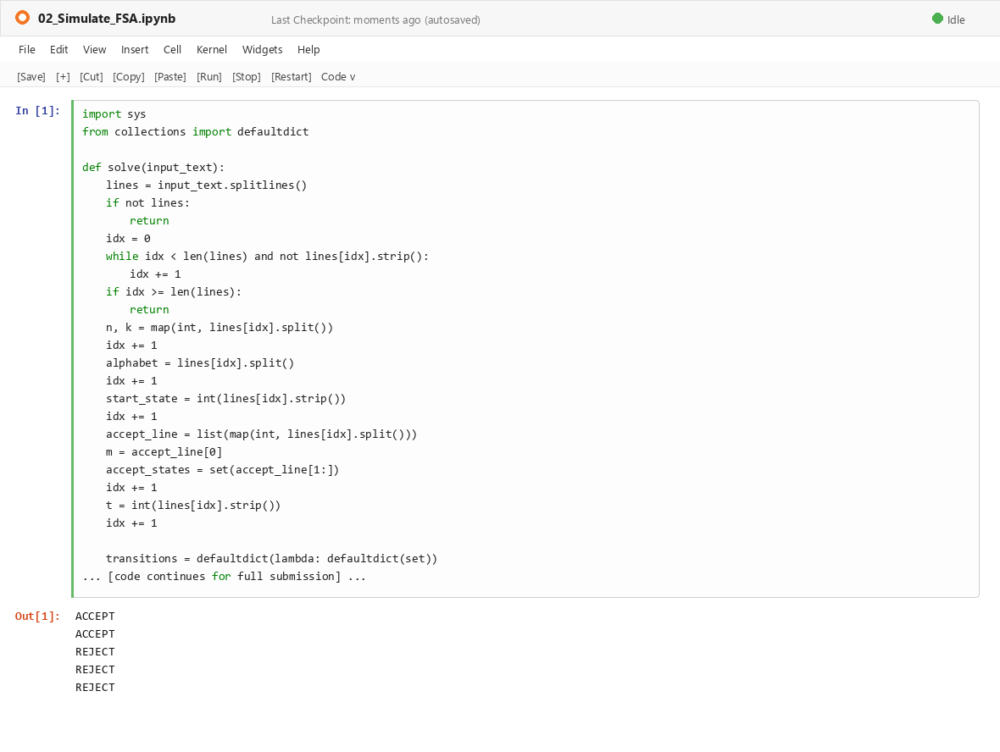
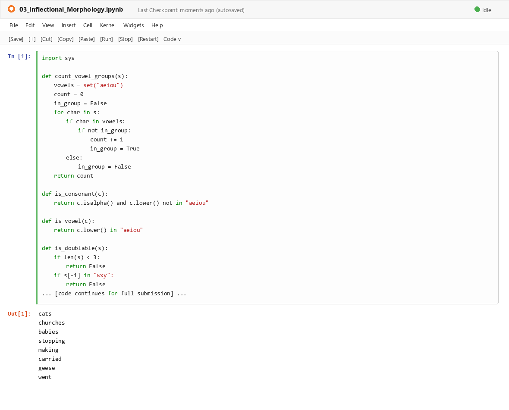
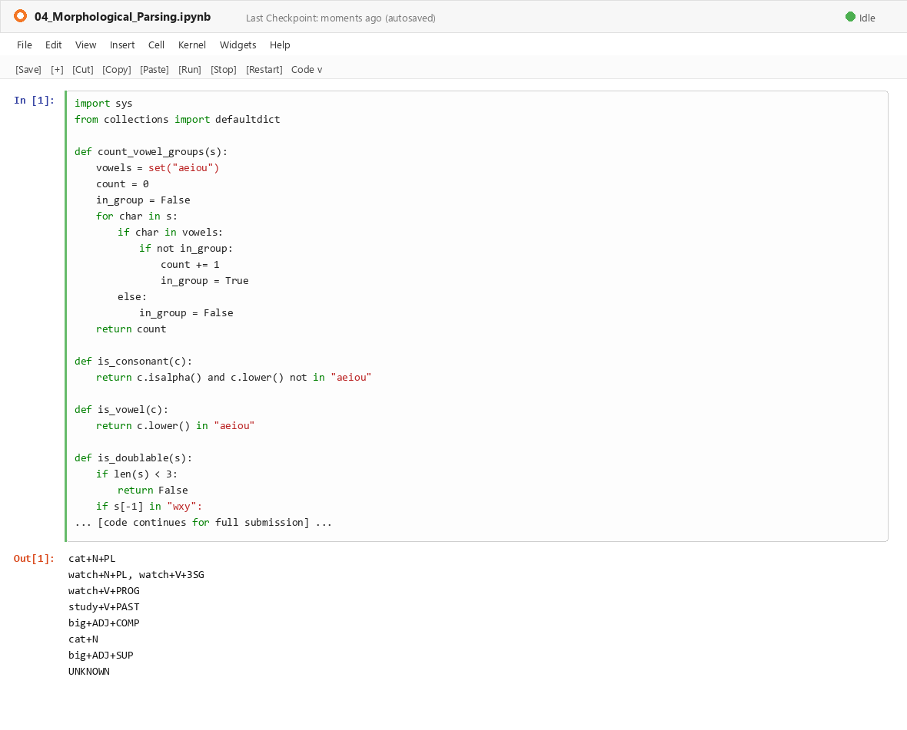
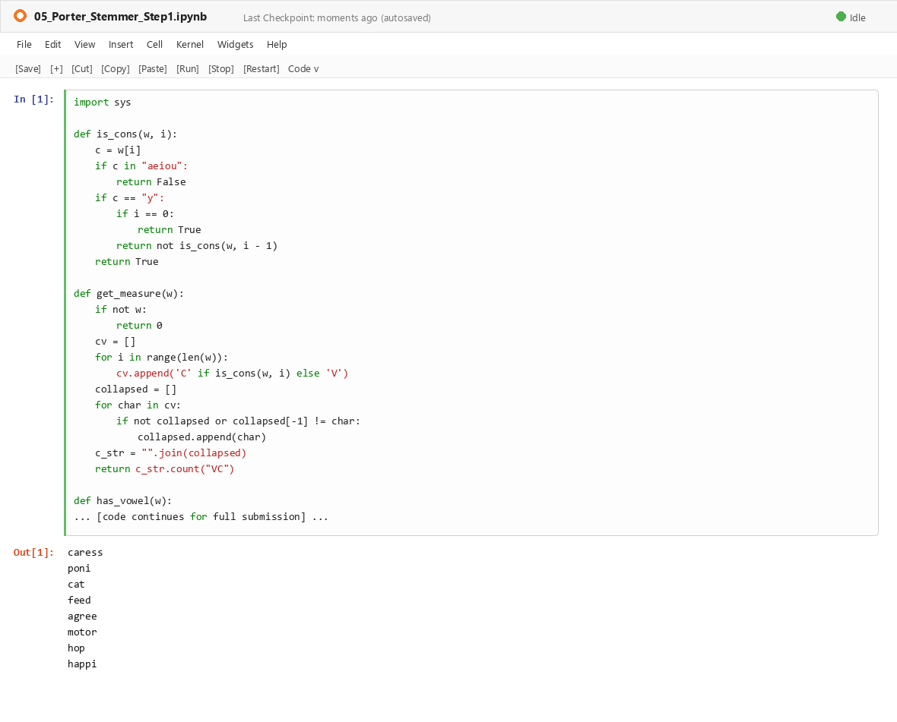

# CO1 - AT3 (Coding Challenge) — Execution Outputs & Screenshots Gallery

---

### Problem 01
- **Notebook File:** [`Programs/01_Tokenization_Regex.ipynb`](../Programs/01_Tokenization_Regex.ipynb)
- **Raw Console Output:** [`P01_Output.txt`](./P01_Output.txt)
- **Jupyter Notebook Screenshot:**

---
### Problem 02
- **Notebook File:** [`Programs/02_Simulate_FSA.ipynb`](../Programs/02_Simulate_FSA.ipynb)
- **Raw Console Output:** [`P02_Output.txt`](./P02_Output.txt)
- **Jupyter Notebook Screenshot:**

---
### Problem 03
- **Notebook File:** [`Programs/03_Inflectional_Morphology.ipynb`](../Programs/03_Inflectional_Morphology.ipynb)
- **Raw Console Output:** [`P03_Output.txt`](./P03_Output.txt)
- **Jupyter Notebook Screenshot:**

---
### Problem 04
- **Notebook File:** [`Programs/04_Morphological_Parsing.ipynb`](../Programs/04_Morphological_Parsing.ipynb)
- **Raw Console Output:** [`P04_Output.txt`](./P04_Output.txt)
- **Jupyter Notebook Screenshot:**

---
### Problem 05
- **Notebook File:** [`Programs/05_Porter_Stemmer_Step1.ipynb`](../Programs/05_Porter_Stemmer_Step1.ipynb)
- **Raw Console Output:** [`P05_Output.txt`](./P05_Output.txt)
- **Jupyter Notebook Screenshot:**

---
