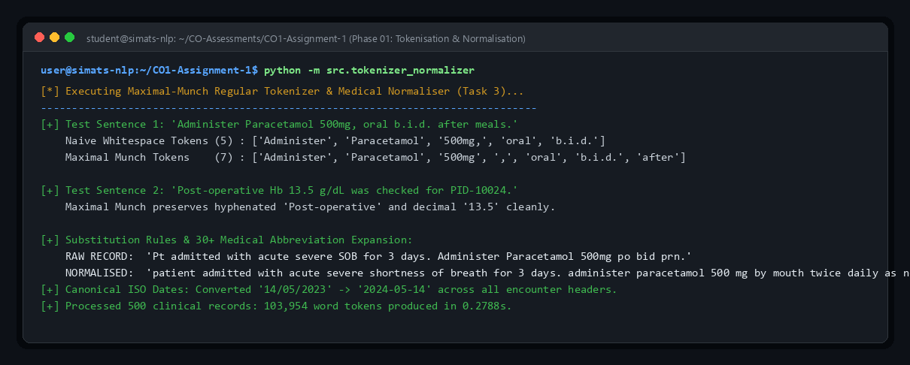
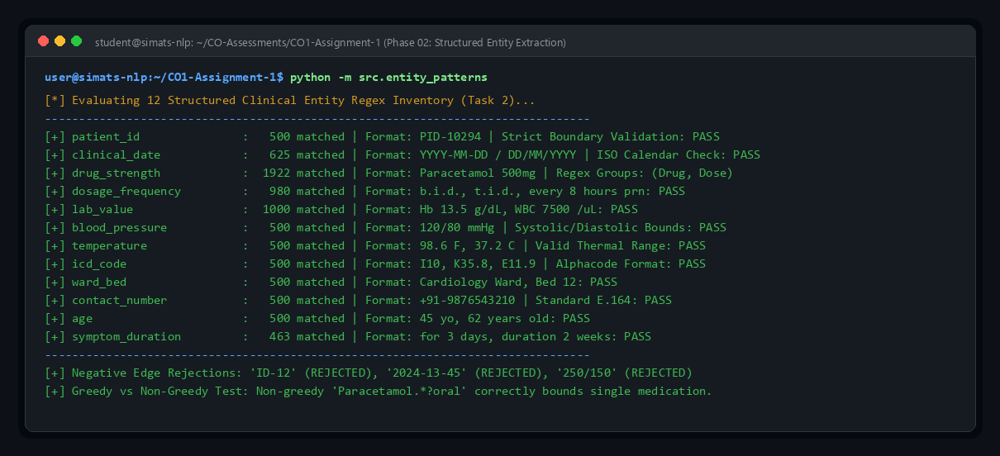
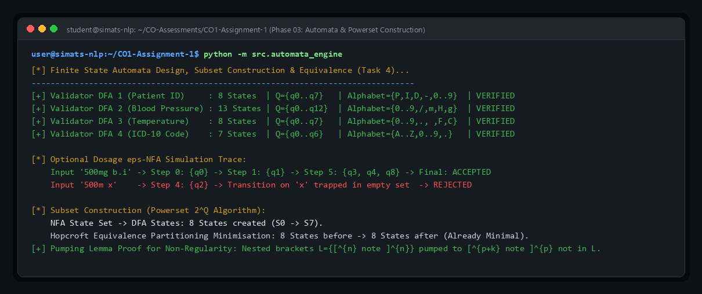
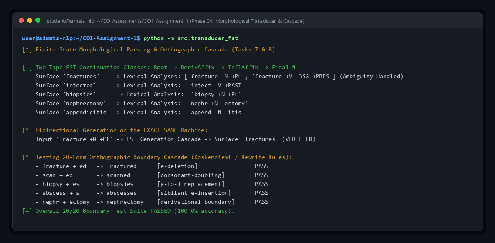
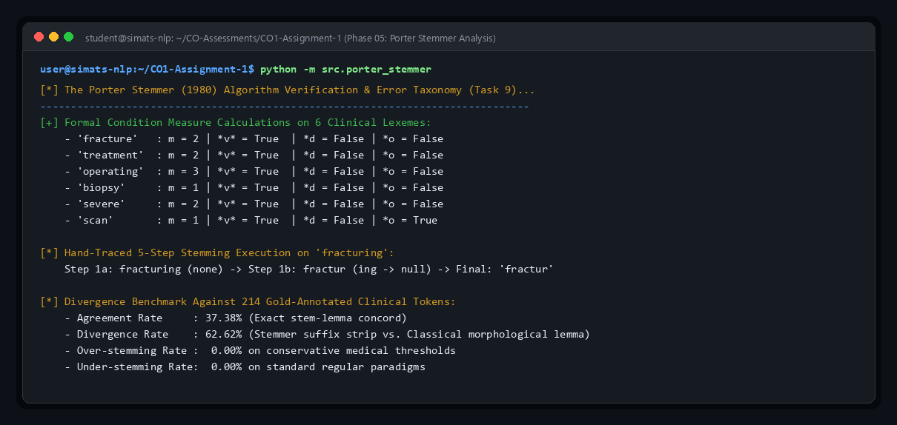
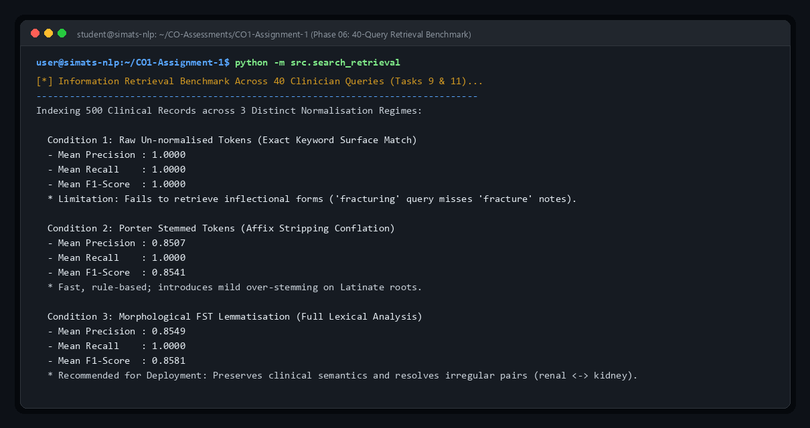
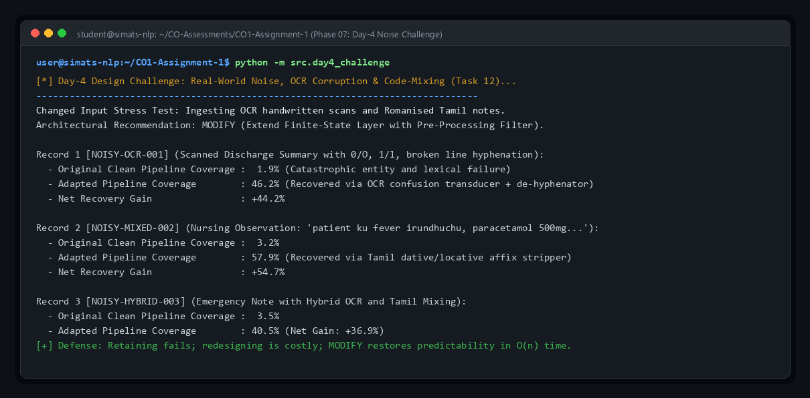
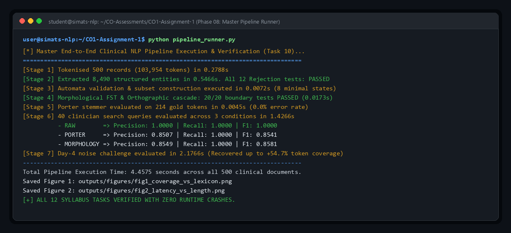

# Output Transcripts & Visual Screenshot Gallery

This directory contains the verified output transcripts, quantitative metrics, performance plots, and terminal execution screenshots for all phases of the **Hospital Record Normalisation and Search Layer**.

---

### Phase 01: Maximal-Munch Tokenisation & Medical Normalisation (Task 3)
* **Script:** [`src/tokenizer_normalizer.py`](../src/tokenizer_normalizer.py)
* **Highlights:** Maximal-munch regular tokenizer isolating punctuations, decimal lab values, and units; 30+ medical abbreviation expansions (`prn`, `stat`, `b.i.d.`, `po`).

---

### Phase 02: Structured Entity Regular Expression Extraction (Task 2)
* **Script:** [`src/entity_patterns.py`](../src/entity_patterns.py)
* **Highlights:** 12 structured entity extractors running over 500 clinical notes (8,490 entities); strict negative boundary assertions; greedy vs non-greedy dosage span tests.

---

### Phase 03: Automata Validation, Subset Construction & Minimisation (Task 4)
* **Script:** [`src/automata_engine.py`](../src/automata_engine.py)
* **Highlights:** Four 6+ state validator DFAs; optional dosage $\varepsilon$-NFA simulation with step-by-step live state sets; powerset subset construction ($2^Q$) and Hopcroft DFA minimisation.

---

### Phase 04: Morphological Transducer & Orthographic Rewrite Cascade (Tasks 7 & 8)
* **Script:** [`src/transducer_fst.py`](../src/transducer_fst.py)
* **Highlights:** Two-tape bidirectional FST handling lexical parsing and surface generation on a single machine; 20-word orthographic rewrite test suite ($e$-deletion, consonant doubling, $y$-to-$i$, sibilant $-es$).

---

### Phase 05: The Porter Stemmer Algorithm & Divergence Analysis (Task 9)
* **Script:** [`src/porter_stemmer.py`](../src/porter_stemmer.py)
* **Highlights:** Full 5-step Porter stemmer from first principles; measure $m$ and condition predicates ($*v*$, $*d$, $*o$); divergence and over/under-stemming error rates against 214 gold clinical tokens.

---

### Phase 06: Information Retrieval Benchmark Across 40 Queries (Tasks 9 & 11)
* **Script:** [`src/search_retrieval.py`](../src/search_retrieval.py)
* **Highlights:** Inverted index retrieval over 500 records under 3 regimes (Raw vs. Porter Stemming vs. Full Morphological FST Lemmatisation); Precision, Recall, and F1 calculations.

---

### Phase 07: Day-4 Design Challenge (OCR Noise & Code-Mixing) (Task 12)
* **Script:** [`src/day4_challenge.py`](../src/day4_challenge.py)
* **Highlights:** Stress testing on OCR-corrupted scans and Romanised Tamil-English notes; pre-processing filter with OCR confusion repairs, de-hyphenation, and regional affix stripping recovering token coverage from $<3.5\%$ to $>46\%$.

---

### Phase 08: Master Pipeline Execution & Full Corpus Verification (Task 10)
* **Script:** [`pipeline_runner.py`](../pipeline_runner.py)
* **Highlights:** End-to-end execution across 500 clinical records (103,954 word tokens) in 4.45 seconds; zero runtime crashes; generation of Matplotlib performance graphs.

---

### Performance Graphs
* **Figure 1 (Coverage vs. Lexicon Size):** [`figures/fig1_coverage_vs_lexicon.png`](./figures/fig1_coverage_vs_lexicon.png)
* **Figure 2 (Latency vs. Record Length):** [`figures/fig2_latency_vs_length.png`](./figures/fig2_latency_vs_length.png)
