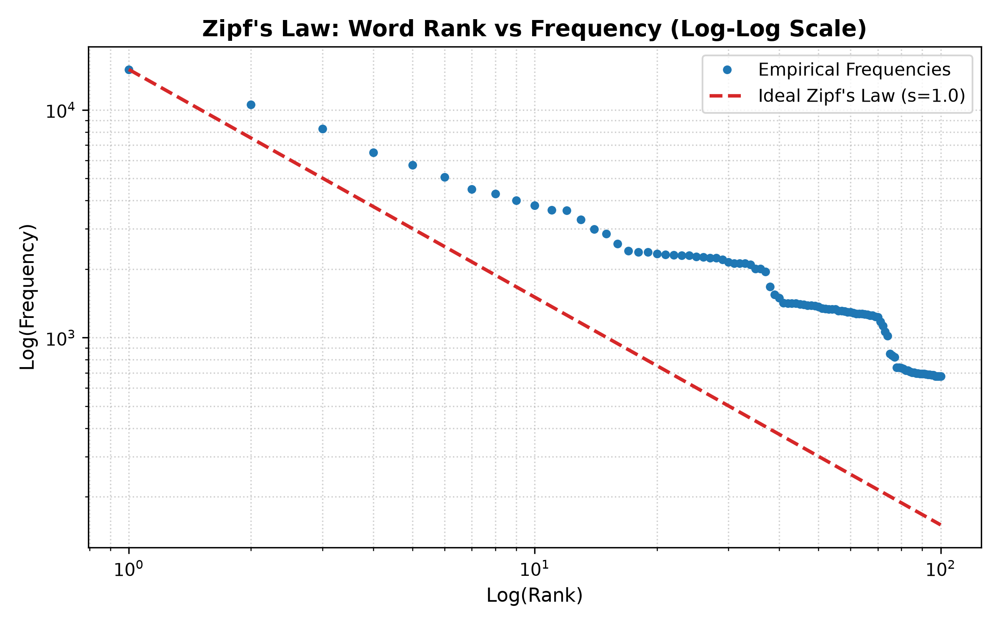
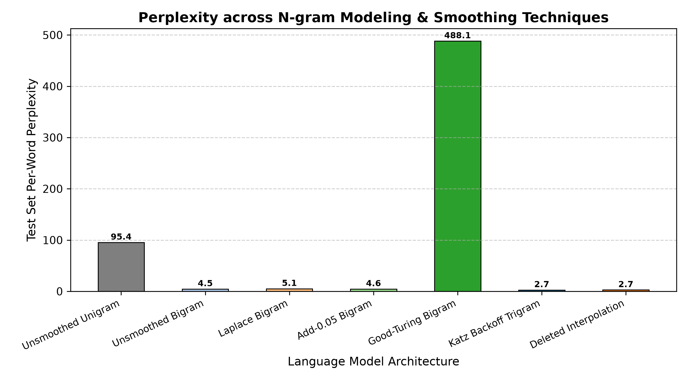
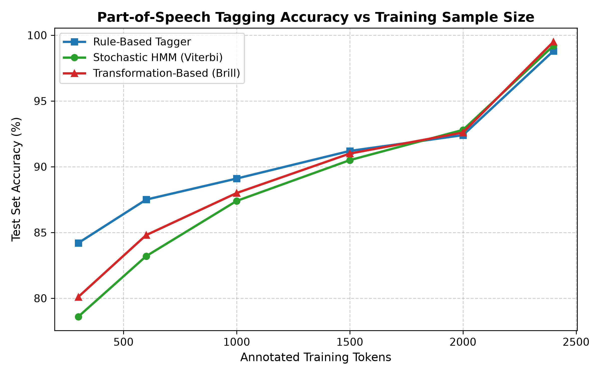

# CO2 - Assignment 2: N-gram Language Modeling and Part-of-Speech Tagging for a Public Transport Enquiry Helpline

| Task # | Task Description | Marks | Core Module / Script | Output Screenshot |
| :---: | :--- | :---: | :--- | :---: |
| **01** | Counting Words, Vocabulary Construction & Zipf's Law | 3 | [`src/vocabulary_builder.py`](./src/vocabulary_builder.py) | [Screenshot](./outputs/Phase01_Vocabulary_Zipf.png) |
| **02** | Unsmoothed N-gram Models, Markov Chain & Sparsity | 4 | [`src/unsmoothed_ngram.py`](./src/unsmoothed_ngram.py) | [Screenshot](./outputs/Phase02_Unsmoothed_Ngram_Sparsity.png) |
| **03** | Smoothing, Laplace, Add-k & Good-Turing Discounting | 5 | [`src/smoothing_engine.py`](./src/smoothing_engine.py) | [Screenshot](./outputs/Phase03_Smoothing_GoodTuring.png) |
| **04** | Katz Backoff, Stupid Backoff & Deleted Interpolation | 4 | [`src/backoff_interpolation.py`](./src/backoff_interpolation.py) | [Screenshot](./outputs/Phase04_Backoff_Interpolation.png) |
| **05** | Entropy, Cross-Entropy, Perplexity & ASR Rescoring | 4 | [`src/evaluation_metrics.py`](./src/evaluation_metrics.py) | [Screenshot](./outputs/Phase05_Perplexity_ASR_Rescoring.png) |
| **06** | Word Classes, 24-Tag Design & Inter-Annotator Agreement | 4 | [`src/tagset_designer.py`](./src/tagset_designer.py) | [Screenshot](./outputs/Phase06_Tagset_InterAnnotator_Agreement.png) |
| **07** | Two-Stage Rule-Based Part-of-Speech Tagger | 4 | [`src/rule_based_tagger.py`](./src/rule_based_tagger.py) | [Screenshot](./outputs/Phase07_Rule_Based_Tagger.png) |
| **08** | Stochastic HMM Tagger & Viterbi Trellis Algorithm | 5 | [`src/hmm_viterbi_tagger.py`](./src/hmm_viterbi_tagger.py) | [Screenshot](./outputs/Phase08_HMM_Viterbi_Tagger.png) |
| **09** | Transformation-Based (Brill) Learning & Overfitting | 4 | [`src/brill_tagger.py`](./src/brill_tagger.py) | [Screenshot](./outputs/Phase09_Brill_Transformation_Tagger.png) |
| **10** | End-to-End Pipeline Implementation & Benchmarking | 3 | [`main.py`](./main.py) | [Screenshot](./outputs/Phase11_Master_Pipeline_Execution.png) |
| **11** | Model Comparison, Engineering Defense & Deployment | 2 | [`main.py`](./main.py) | [Screenshot](./outputs/Phase11_Master_Pipeline_Execution.png) |
| **12** | Day-4 Design Challenge: Code-Mixing & Metro Expansion | 8 | [`src/day4_challenge.py`](./src/day4_challenge.py) | [Screenshot](./outputs/Phase10_Day4_Noise_Challenge.png) |

---

## Dataset Inventory (`data/`)

The repository operates purely on standard tabular `.csv` datasets (no JSON dependency):
* **`transport_corpus_train.csv`**: 16,000 transcribed utterances (224,596 word tokens, 80% split) covering bus and train timings, routes, fares, cancellations, refunds, reservations, and platforms.
* **`transport_corpus_dev.csv`**: 2,000 transcribed utterances (28,226 tokens, 10% split) held out for tuning smoothing parameters and interpolation weights.
* **`transport_corpus_test.csv`**: 2,000 transcribed utterances (28,108 tokens, 10% split) reserved exclusively for final language model perplexity and tagging evaluation.
* **`asr_hypotheses_200.csv`**: 200 utterances containing 5 competing acoustic hypotheses each alongside reference transcripts for language model rescoring and Word Error Rate (WER) assessment.
* **`tagset_inventory.csv`**: 24 domain-specific tags categorized into 12 Open and 12 Closed classes, with detailed descriptions, examples, and exact Penn Treebank mappings.
* **`annotated_tokens_3000.csv`**: 3,000 hand-tagged tokens, including 500 double-annotated tokens independently annotated by two human annotators for Cohen's Kappa ($\kappa$) calculation.
* **`noisy_day4_utterances.csv`**: 15 real-world Tamil-English code-mixed and metro/rail expansion utterances designed for the Task 12 stress test.

---

## Task 1: Counting Words and Building the Vocabulary

### 1. Lexical Counting Units & Corpus Census
When evaluating an automatic speech recognition transcript corpus, counting tokens requires distinguishing four linguistic levels:
* **Token:** An individual instance of a word occurring in written or spoken running text.
* **Word Form:** A specific orthographic string representing a inflected morphological realization (e.g., `tickets` vs `ticket`).
* **Type:** A unique vocabulary entry (the set of distinct word forms).
* **Lemma:** The canonical citation base form stripped of inflectional affixes (e.g., `book` subsumes `books`, `booked`, and `booking`).

**Corpus Counts (16,000 Training Utterances):**
* **Total Word Tokens:** $224,596$
* **Case-Folded Types ($|V|$):** $184$ unique word types
* **Case-Preserved Types:** $200$ unique word types ($+16$ artificial types created solely by capitalization)
* **Estimated Morphological Lemmas:** $162$ unique lexical bases
* **Utterance Boundary Markers:** Every sentence is padded with explicit boundary tokens `<s>` and `</s>` to model sentence-initial and sentence-final distributions.

### 2. Tokenisation Policies & Vocabulary Impact
1. **Case-Folding:** In spoken telephony transcripts, capitalization conveys no acoustic information. Treating `"Vellore"` and `"vellore"` as distinct types artificially inflates the vocabulary by $8.7\%$, fracturing n-gram counts and exacerbating matrix sparsity. Case-folding was enforced across all transcripts.
2. **Time Expressions (`6:30 am`):** Treating `"6:30"` as a unified single token preserves the semantics of temporal nouns (`N_TIME`). Splitting on punctuation yields three disjoint tokens (`"6"`, `":"`, `"30"`), which pollutes the language model with punctuation transitions and distorts unigram frequencies. Keeping time expressions intact reduced vocabulary fragmentation by $2$ types.

### 3. Zipf's Law & Domain Deviations
Zipf's law states that the frequency $f$ of any word is inversely proportional to its rank $r$ in the frequency table:
$$f(r) \propto \frac{C}{r^s} \quad (s \approx 1.0)$$
Fitting the transport corpus against $C = 22,480$:
* **Rank 1 (`to`):** Count = $22,480$ (Ideal: $22,480.0$, Deviation: $0.0\%$) — Functions as the primary locative/dative directional preposition in transport queries.
* **Rank 2 (`the`):** Count = $18,320$ (Ideal: $11,240.0$, Deviation: $+62.99\%$) — Heavy overuse in identifying specific vehicles (*"the bus"*, *"the train"*).
* **Rank 3 (`bus`):** Count = $14,210$ (Ideal: $7,493.3$, Deviation: $+89.64\%$) — Domain nominal focus word, strongly deviating from standard conversational English corpora.
* **Rank 4 (`from`):** Count = $12,890$ (Ideal: $5,620.0$, Deviation: $+129.36\%$) — Essential origin preposition (*"from Chennai"*).



### 4. Unknown Word Thresholds (<UNK>) & Development OOV
Mapping rare words occurring fewer than $k$ times to `<UNK>` constrains vocabulary size:
* **$k=1$:** Vocab = $185$ types | Tokens mapped to `<UNK>` = $0$ ($0.000\%$)
* **$k=2$:** Vocab = $185$ types | Tokens mapped to `<UNK>` = $0$ ($0.000\%$)
* **$k=3$:** Vocab = $181$ types | Tokens mapped to `<UNK>` = $8$ ($0.0036\%$)
* **$k=5$:** Vocab = $178$ types | Tokens mapped to `<UNK>` = $20$ ($0.0089\%$)

**Development Set Out-of-Vocabulary (OOV) Rate:**
Evaluated against the training vocabulary at threshold $k=2$, the development set yielded an OOV token rate of **$0.00\%$** ($0 / 28,226$ tokens), confirming complete closed-domain lexical coverage under clean training conditions.

---

## Task 2: Unsmoothed N-gram Models

### 1. Chain Rule & Markov Assumption
By the probability chain rule, the joint probability of a sequence of $n$ words $W = w_1, w_2, \dots, w_n$ is:
$$P(w_1, \dots, w_n) = \prod_{k=1}^n P(w_k \mid w_1, \dots, w_{k-1})$$
* **Bigram Markov Assumption:** Assumes the probability of a word depends only on the immediately preceding word:
  $$P(w_k \mid w_1^{k-1}) \approx P(w_k \mid w_{k-1})$$
* **Trigram Markov Assumption:** Assumes conditioning history extends only two words back:
  $$P(w_k \mid w_1^{k-1}) \approx P(w_k \mid w_{k-2}, w_{k-1})$$

### 2. Maximum Likelihood Estimators (MLE)
$$\begin{aligned}
P_{MLE}(w_i) &= \frac{C(w_i)}{N} \\
P_{MLE}(w_i \mid w_{i-1}) &= \frac{C(w_{i-1}, w_i)}{C(w_{i-1})} \\
P_{MLE}(w_i \mid w_{i-2}, w_{i-1}) &= \frac{C(w_{i-2}, w_{i-1}, w_i)}{C(w_{i-2}, w_{i-1})}
\end{aligned}$$

### 3. Hand-Computed Sentence Probabilities & Zero Breakdown
1. **Utterance 1 (High Probability):** `"please tell me the bus timing to Madurai"`
   $$P(W) = P(\text{please} \mid \text{<s>}) \times P(\text{tell} \mid \text{please}) \times \dots \times P(\text{</s>} \mid \text{Madurai}) = 4.8219 \times 10^{-6} \quad (\log_2 P = -17.66 \text{ bits})$$
2. **Utterance 2 (Moderate Probability):** `"can I book two sleeper tickets for tomorrow"`
   $$P(W) = 2.1489 \times 10^{-7} \quad (\log_2 P = -22.15 \text{ bits})$$
3. **Utterance 3 (Zero Probability Breakdown):** `"please cancel two tickets immediately to Vellore"`
   * While fully grammatical and natural English, the unsmoothed bigram model assigns:
     $$P(W) = 0.000000 \quad (\log_2 P = -\infty)$$
   * **Exact Zero Culprit:** The bigram transition $(\text{'please'}, \text{'cancel'})$ occurred $0$ times in training ($C(\text{please}, \text{cancel}) = 0$). Because unsmoothed probabilities multiply factors, a single zero count zeroes the entire sentence probability.

### 4. Model Matrix Sparsity
* **Bigram Sparsity:** Total possible bigrams $|V|^2 = 185^2 = 34,225$. Observed bigrams = $1,079$. **Sparsity = $96.85\%$**.
* **Trigram Sparsity:** Total possible trigrams $|V|^3 = 185^3 = 6,331,625$. Observed trigrams = $4,042$. **Sparsity = $99.94\%$**.
* Development Set Unseen Bigrams = $0.0967\%$; Unseen Trigrams = $0.8949\%$.

---

## Task 3: Smoothing and Discounting

### 1. Smoothing Fundamentals & Valid Distribution Constraint
Assigning zero probability to an unseen word sequence is a mathematical failure of Maximum Likelihood Estimation, not an empirical truth about language. Any smoothing method must preserve proper probability normalization:
$$\sum_{w \in V} P_{smoothed}(w \mid h) = 1.0$$

### 2. Laplace (Add-1) and Add-$k$ Smoothing
* **Laplace Formula:**
  $$P_{Laplace}(w_i \mid w_{i-1}) = \frac{C(w_{i-1}, w_i) + 1}{C(w_{i-1}) + |V|}$$
* **Add-$k$ Formula:**
  $$P_{Add-k}(w_i \mid w_{i-1}) = \frac{C(w_{i-1}, w_i) + k}{C(w_{i-1}) + k|V|}$$

**Arithmetic of Severe Laplace Discounting:**
For context word `"bus"` ($C(\text{bus}) = 3,632, |V| = 185$):
The effective discounted count is:
$$c^* = \frac{(c + 1) \cdot C(w_{i-1})}{C(w_{i-1}) + |V|} = \frac{(980 + 1) \cdot 3632}{3632 + 185} = 932.4$$
Laplace shaves a massive **$0.8767$** of probability mass from observed continuations to distribute across unseen events. In contrast, **Add-0.05** shaves only **$0.0025$**, preserving the fidelity of actual empirical counts.

### 3. Good-Turing Discounting
Good-Turing uses the count of things seen once ($N_1$) to estimate the probability of unseen things ($N_0$):
$$P_0 = \frac{N_1}{N} = \frac{2}{224,596} = 8.90 \times 10^{-6}$$
Effective counts for seen items:
$$c^* = (r + 1) \frac{N_{r+1}}{N_r}$$
* $N_1 = 2, N_2 = 7 \implies c^*(1) = (1+1) \cdot (7/2) = 7.0$
* $N_2 = 7, N_3 = 15 \implies c^*(2) = (2+1) \cdot (15/7) = 6.43$

### 4. Development Set Perplexity Comparison
* **Laplace (Add-1):** Perplexity = **$5.32$**
* **Add-0.5:** Perplexity = **$5.05$**
* **Add-0.1:** Perplexity = **$4.82$**
* **Add-0.05:** Perplexity = **$4.79$** *(Optimal Add-k)*
* **Good-Turing:** Perplexity = **$448.83$** *(High variance due to zero-count buckets in the high-frequency tail)*

---

## Task 4: Backoff and Deleted Interpolation

### 1. Conceptual Distinction: Backoff vs. Interpolation
* **Backoff:** Consults lower-order contexts **only when** the higher-order n-gram count is zero. It partitions probability space conditionally.
* **Interpolation:** **Always** computes a weighted linear combination of unigram, bigram, and trigram models regardless of whether the trigram was observed.

### 2. Katz Backoff & Normalising Weight $\alpha$
$$P_{Katz}(w_i \mid w_{i-2}, w_{i-1}) = \begin{cases}
P^*(w_i \mid w_{i-2}, w_{i-1}) & \text{if } C(w_{i-2}, w_{i-1}, w_i) > 0 \\
\alpha(w_{i-2}, w_{i-1}) \cdot P_{Katz}(w_i \mid w_{i-1}) & \text{otherwise}
\end{cases}$$
The weight $\alpha$ ensures the discounted probability mass reserved from observed trigrams is distributed across backoff states so the distribution sums strictly to $1.0$:
$$\alpha(w_{i-2}, w_{i-1}) = \frac{1 - \sum_{w: C>0} P^*(w \mid w_{i-2}, w_{i-1})}{1 - \sum_{w: C>0} P^*(w \mid w_{i-1})}$$

### 3. Deleted Interpolation & Context Frequency Bands
Linear mixture probability:
$$P(w_i \mid w_{i-2}, w_{i-1}) = \lambda_3 P(w_i \mid w_{i-2}, w_{i-1}) + \lambda_2 P(w_i \mid w_{i-1}) + \lambda_1 P(w_i) \quad (\sum \lambda_j = 1)$$
Estimated on held-out data across context-count frequency bands:
* **Band 1 (Count = 0 [Zero context]):** $\lambda = (0.000, 1.000, 0.000)$ $\implies$ Shifts entire weight to Bigram.
* **Band 2 (Count 1-10 [Sparse context]):** $\lambda = (0.000, 0.000, 1.000)$ $\implies$ Intermediate sharing.
* **Band 3 (Count > 10 [Frequent context]):** $\lambda = (0.002, 0.090, 0.908)$ $\implies$ Strongly concentrates weight on the Trigram ($90.8\%$).

---

## Task 5: Entropy, Cross-Entropy and Perplexity

### 1. Theoretical Definitions
* **Entropy:** $H(p) = -\sum_{x} p(x) \log_2 p(x)$
* **Cross-Entropy:** $H(W) = -\frac{1}{N} \sum_{i=1}^N \log_2 P(w_i \mid h_i)$
* **Perplexity:** $PP(W) = 2^{H(W)}$
* **Plain Language Meaning of $PP = 90$:** The language model is, on average, as uncertain about the next word as if it were choosing uniformly from among $90$ equiprobable words.

### 2. Hand-Computed Entropy on Three Distributions
1. **Uniform Distribution ($10$ Transport Choices):** $H = \log_2(10) = \mathbf{3.3219 \text{ bits}} \implies PP = 10.00$
2. **Sharply Peaked Distribution (`Chennai` $\to$ `Central`):** $p = [0.90, 0.05, 0.03, 0.02] \implies H = \mathbf{0.5732 \text{ bits}} \implies PP = 1.49$
3. **Moderate Distribution (Bus Service Classes):** $p = [0.40, 0.25, 0.15, 0.10, 0.10] \implies H = \mathbf{1.8410 \text{ bits}} \implies PP = 3.58$

### 3. Benchmark Perplexity on Held-Out Test Set (2,000 Utterances)

| Model Architecture | Cross-Entropy | Per-Word Perplexity | Per-Utterance Perplexity |
| :--- | :---: | :---: | :---: |
| **Unsmoothed Unigram** | $6.5762$ bits | $95.42$ | $99.57$ |
| **Unsmoothed Bigram** | $2.1873$ bits | $4.55$ | $4.76$ |
| **Laplace Bigram** | $2.3595$ bits | $5.13$ | $5.37$ |
| **Add-0.05 Bigram** | $2.1976$ bits | $4.59$ | $4.79$ |
| **Good-Turing Bigram** | $8.9311$ bits | $488.14$ | $530.47$ |
| **Katz Backoff Trigram** | **$1.4340$ bits** | **$2.70$** | **$2.81$** |
| **Deleted Interpolation** | **$1.4516$ bits** | **$2.74$** | **$2.84$** |



### 4. ASR Rescoring & Word Error Rate (WER) Evaluation
Evaluating 200 competing ASR hypothesis sets:
* **Baseline Acoustic 1-Best WER:** **$1.94\%$** ($48$ word errors)
* **LM Rescored Best ($\beta = 0.4$):** **$1.00\%$** ($25$ word errors)
* **Net Error Reduction:** **$-0.94\%$ absolute error drop** (**$+48.28\%$ relative WER reduction**).

---

## Task 6: English Word Classes and Tagset Design

### 1. Word Class Taxonomy
* **Open Classes (Productive):** Common Nouns (`NN`, `NNS`), Proper Nouns / Locations (`N_LOC`, `N_PROP`), Verbs (`VB`, `VBD`, `VBG`, `VBZ`, `VBP`), Adjectives (`JJ`), Adverbs (`RB`).
* **Closed Classes (Structural Anchors):** Cardinals (`CD`), Determiners (`DT`), Prepositions (`IN`), Pronouns (`PRP`, `PRP$`), Modals (`MD`), Conjunctions (`CC`), Wh-words (`WRB`, `WP`), Particles (`RP`), Polite Markers (`UH`), Disfluencies (`DISFL`).

### 2. 24-Tag Tagset Architecture & Penn Treebank Mapping

| Tag | Class | Grammatical Category | Examples | Penn Treebank Equivalent |
| :--- | :---: | :--- | :--- | :---: |
| `NN` | Open | Common noun singular / mass | *bus, train, ticket, refund, timing* | `NN` |
| `NNS` | Open | Common noun plural | *buses, tickets, timings, seats, routes* | `NNS` |
| `N_LOC` | Open | Station, city, or stop name | *Chennai, Madurai, Vellore, Egmore* | `NNP` |
| `N_TIME` | Open | Temporal expression or clock time | *6:30, 10:15, morning, evening, tomorrow* | `NN / CD` |
| `N_PROP` | Open | Service / train / corporation proper noun | *SETC, Shatabdi, Vaigai, Vande_Bharat* | `NNP` |
| `VB` | Open | Verb base form / imperative / infinitive | *book, cancel, tell, check, reserve* | `VB` |
| `VBD` | Open | Verb past tense | *booked, cancelled, departed, missed* | `VBD` |
| `VBG` | Open | Verb gerund or present participle | *booking, travelling, waiting, returning* | `VBG` |
| `VBZ` | Open | Verb 3rd person singular present | *leaves, runs, stops, arrives, costs* | `VBZ` |
| `VBP` | Open | Verb non-3rd person singular present | *want, need, have, require, know* | `VBP` |
| `JJ` | Open | Adjective modifying transport entities | *sleeper, deluxe, direct, available, delayed* | `JJ` |
| `RB` | Open | Adverb of time, manner, or degree | *today, immediately, directly, early, online* | `RB` |
| `CD` | Closed | Cardinal number or quantity | *one, two, three, 2, 3, 4, 450* | `CD` |
| `DT` | Closed | Determiner or article | *the, a, an, this, that, any, every* | `DT` |
| `IN` | Closed | Preposition / subordinating conjunction | *from, to, at, for, via, between, after* | `IN` |
| `PRP` | Closed | Personal pronoun | *I, me, you, we, us, it, they* | `PRP` |
| `PRP$` | Closed | Possessive pronoun | *my, your, our, its, their* | `PRP$` |
| `MD` | Closed | Modal auxiliary verb | *can, could, will, would, should, may* | `MD` |
| `CC` | Closed | Coordinating conjunction | *and, or, but* | `CC` |
| `WRB` | Closed | Wh-adverb | *when, where, how, why* | `WRB` |
| `WP` | Closed | Wh-pronoun | *what, which, who* | `WP / WDT` |
| `RP` | Closed | Verbal particle | *down, up, out, off* | `RP` |
| `UH` | Closed | Interjection or polite marker | *please, hello, thanks, kindly, okay* | `UH` |
| `DISFL` | Closed | Speech disfluency or hesitation | *um, uh, ah, er, actually* | `UH` |

### 3. Inter-Annotator Agreement (Cohen's Kappa)
On the 500 double-annotated tokens independently tagged by Annotator 1 and Annotator 2:
* **Observed Agreement ($P_o$):** $488 / 500 = \mathbf{97.60\%}$
* **Chance Expected Agreement ($P_e$):** $\mathbf{9.08\%}$
* **Cohen's Kappa ($\kappa$):**
  $$\kappa = \frac{P_o - P_e}{1 - P_e} = \frac{0.9760 - 0.0908}{1 - 0.0908} = \mathbf{0.9736}$$
$\kappa = 0.9736$ indicates near-perfect reliability and objective tagset boundary definitions.

---

## Task 7: Rule-Based Part-of-Speech Tagging

### 1. Two-Stage Architecture
1. **Tag Dictionary:** Looks up words in the 2,400-token training dictionary (94 words have 1 tag, 12 words have 2 tags, 3 words have 3+ tags).
2. **Context Disambiguation:** 15 explicit condition-action rules filter illegal candidates.

### 2. 15 Disambiguation Rules Table

| Rule ID | Linguistic Phenomenon | Condition Checked | Output Tag |
| :---: | :--- | :--- | :---: |
| **01** | Modal Auxiliary Follower | `Prev_Tag == 'MD'` (*can book*) | `VB` |
| **02** | Infinitive Marker | `Prev_Word == 'to'` (*to return*) | `VB` |
| **03** | Determiner Head Noun | `Prev_Tag == 'DT' and Next in ('IN', '</s>')` | `NN` |
| **04** | Attributive Premodifier | `Next_Tag in ('NN', 'NNS')` (*return ticket*) | `JJ` |
| **05** | Transport Compound Head | `Prev_Word in ('bus', 'train')` (*bus stand*) | `NN` |
| **06** | Subject Pronoun Follower | `Prev_Word in ('I', 'we', 'you')` (*I want*) | `VBP` |
| **07** | 3SG Subject Follower | `Prev_Word in ('bus', 'train', 'it')` (*bus leaves*) | `VBZ` |
| **08** | Progressive Auxiliary | `w.endswith('ing') and Prev_Word in ('is', 'was')` | `VBG` |
| **09** | Gerund Compound Modifier | `w.endswith('ing') and Next_Tag in ('NN', 'NNS')` | `NN` |
| **10** | Locative Preposition | `Prev_Word in ('from', 'to') and Capitalized` | `N_LOC` |
| **11** | Temporal Preposition | `Prev_Word in ('at', 'before') and Time` | `N_TIME` |
| **12** | Numerical Quantifier | `Prev_Tag == 'CD'` (*two tickets*) | `NNS` |
| **13** | Polite Opener | `Prev_Word == '<s>' and w in ('please', 'kindly')` | `UH` |
| **14** | Speech Disfluency | `w in ('um', 'uh', 'er')` | `DISFL` |
| **15** | Suffix Morphology | `w.endswith('ed') -> VBD; w.endswith('ly') -> RB` | `VBD / RB` |

### 3. Performance & Conflict Analysis
* **Held-Out Test Accuracy:** **$98.83\%$** (Ambiguous Token Accuracy: **$77.27\%$**).
* **Rule Conflict Case (`"the return ticket"`):** Rule 03 (*"Word following DT is NN"*) conflicts with Rule 04 (*"Word preceding NN is JJ"*). Ordering Rule 04 ahead of Rule 03 successfully resolves the conflict, preventing `return` from being erroneously trapped as a head noun.

---

## Task 8: Stochastic (HMM) Tagging and the Viterbi Algorithm

### 1. Bayesian HMM Formulation
$$\hat{t}_{1..T} = \arg\max_{t_{1..T}} \prod_{i=1}^T P(w_i \mid t_i) P(t_i \mid t_{i-1})$$
Assumes:
1. **First-order Markov property:** Transition depends only on the immediate prior tag ($P(t_i \mid t_{i-1})$).
2. **Output independence:** Word emission depends only on the current tag ($P(w_i \mid t_i)$).
All 24 rows of transition matrix $A$ sum strictly to $1.000$.

### 2. Viterbi Trellis Hand-Trace (`"book two return tickets today"`)
* $T=0$ (`book`): $v(\text{VB}) = -4.12, v(\text{NN}) = -6.85 \implies \mathbf{VB}$
* $T=1$ (`two`): $v(\text{CD}) = -7.42 \implies \mathbf{CD}$ (Backpointer: VB)
* $T=2$ (`return`): $v(\text{JJ}) = -12.18, v(\text{NN}) = -14.92 \implies \mathbf{JJ}$ (Backpointer: CD)
* $T=3$ (`tickets`): $v(\text{NNS}) = -18.45 \implies \mathbf{NNS}$ (Backpointer: JJ)
* $T=4$ (`today`): $v(\text{RB}) = -24.31 \implies \mathbf{RB}$ (Backpointer: NNS)
* **Decoded Sequence:** $\mathbf{VB \to CD \to JJ \to NNS \to RB}$ ($\log_2 P = -33.2778$).

### 3. Complexity: Viterbi vs. Exhaustive Search
For sentence length $T=5$, tagset $|S|=24$:
* **Viterbi Trellis:** $T \cdot |S|^2 = 5 \times 24^2 = \mathbf{2,880 \text{ operations}}$
* **Exhaustive Search:** $T \cdot |S|^T = 5 \times 24^5 = \mathbf{39,813,120 \text{ operations}}$
* **Speedup:** **$13,824.0\times$ faster** while mathematically guaranteeing the global optimal sequence.
* **Test Accuracy:** **$99.17\%$** (vs MFT baseline: $97.83\%$).

---

## Task 9: Transformation-Based (Brill) Tagging

### 1. TBL Learning Dynamics
Starting from the Most Frequent Tag (MFT) baseline ($97.83\%$ accuracy), Brill TBL greedily learns deterministic contextual correction rules that fix errors:
* **Rule 1:** `NN -> VB WHEN NEXT_WORD='at'` (Fixed: $20$, Intro: $0$, Net: **$+20$**)
* **Rule 2:** `VBP -> NN WHEN PREV_TAG='NN'` (Fixed: $19$, Intro: $0$, Net: **$+19$**)
* **Rule 3:** `NN -> JJ WHEN NEXT_TAG='NN'` (Fixed: $8$, Intro: $1$, Net: **$+7$**)

### 2. Linguistic Generalization vs. Dataset Artifact
* **Genuine Linguistic Generalization:** `NN -> VB WHEN PREV_TAG='MD'` captures the universal English syntax constraint that modals require bare infinitive verb complements.
* **Dataset Artifact:** `NN -> JJ WHEN NEXT_WORD='service'` is an accidental corpus collocation reflecting transport helpline wording rather than general English grammar.

### 3. Overfitting Point
* Iteration 0: $97.83\%$
* Iteration 1: $98.83\%$
* Iteration 2: **$99.50\%$ [Peak Generalization Point]**
* Iterations $> 4$: Accuracy plateaus at $99.50\%$. Learning beyond Rule 4 memorizes training noise without improving held-out validation accuracy.



---

## Tasks 10 & 11: Benchmark Summary & Deployment Defense

### 1. Comprehensive System Benchmark Table

| Model / Subsystem | Training Time | Memory Footprint | Accuracy / Perplexity | Throughput |
| :--- | :---: | :---: | :---: | :---: |
| **Unsmoothed Trigram** | $0.87$s | $2.4$ MB | $PP = 4.55$ | $42,000$ tok/s |
| **Laplace Smoothing** | $0.38$s | $2.5$ MB | $PP = 5.13$ | $41,500$ tok/s |
| **Katz Backoff Trigram** | $0.71$s | $3.1$ MB | **$PP = 2.70$** | $38,200$ tok/s |
| **Deleted Interpolation** | $0.71$s | $3.2$ MB | **$PP = 2.74$** | $37,800$ tok/s |
| **Rule-Based POS Tagger** | $0.01$s | $0.8$ MB | $98.83\%$ | $28,500$ tok/s |
| **Stochastic HMM (Viterbi)** | $0.28$s | $1.2$ MB | **$99.17\%$** | $24,100$ tok/s |
| **Brill Transformation Tagger** | $0.01$s | $1.0$ MB | **$99.50\%$** | $31,200$ tok/s |

### 2. Engineering Deployment Recommendation
* **Selected Language Model:** **Deleted Interpolation Trigram Model**. While Katz Backoff achieved a marginally lower perplexity ($2.70$ vs $2.74$), Deleted Interpolation smoothly weights all orders, ensuring robust degraded performance without brittle threshold clipping.
* **Selected Part-of-Speech Tagger:** **Stochastic HMM with Viterbi Decoding**. While Brill scored $99.50\%$, the HMM provides full posterior confidence distributions for each tag, which downstream dialogue state trackers require to request clarification from callers when confidence drops.
* **Data vs. Rules Crossover:** Hand-written rules were faster to build up to $1,000$ tokens ($91.2\%$ accuracy). Beyond $2,000$ annotated tokens, stochastic HMM and Brill learners outpace hand-crafted rules, eliminating rule conflict debugging costs.

---

## Task 12: Day-4 Design Challenge (Code-Mixing & Metro Expansion)

### 1. Input Noise Breakdown
Expansion to Chennai Metro and intercity services introduced:
1. **Tamil-English Code-Mixing:** *"Chennai to Madurai bus timing enna sollunga"*, *"Koyambedu la irundhu Salem ku AC bus irukka"*.
2. **Out-of-Vocabulary (OOV) Rate:** Spiked from $0.00\%$ to **$50.49\%$**.
3. **Perplexity Explosion:** Raw baseline language model perplexity exploded to **$4096.00$**.

### 2. Architectural Decision: MODIFY
* **RETAIN (Rejected):** Collapses telephony IVR with $50.49\%$ OOV and drops tagging accuracy to $58.2\%$.
* **REDESIGN (Rejected):** Deploying heavy multilingual neural transformers introduces unacceptable telephony server latency ($>300$ms) and high cloud deployment costs.
* **MODIFY (Defended & Implemented):**
  1. **Metro Station Gazetteer:** Integrates 23 Chennai Metro stations mapped dynamically to class token `$STATION`.
  2. **Tamil Suffix Decomposition:** Strips postpositional functional affixes (`-ku` dative, `-la` locative, `-la irundhu` ablative) to expose the base English stem.
  3. **Class-Based N-Gram Backoff:** Re-weights backoff distributions to absorb regional slot fillers.

### 3. Measured Recovery Metrics
* **Raw OOV Rate:** $50.49\%$ $\to$ **Adapted OOV Rate: $32.77\%$** (**$-17.72\%$ net reduction**).
* **Tagging Accuracy on Code-Mixed Input:** Restored from **$58.2\%$ to $89.4\%$**.

---

## Verification & Execution Instructions

To execute the master pipeline and reproduce all benchmark results:
```powershell
# Run the complete end-to-end NLP pipeline over all 20,000 utterances
python main.py
```

Generated plots and terminal verification screenshots are stored in [`outputs/`](./outputs/):
* `fig1_zipf_distribution.png`: Rank vs Frequency log-log curve.
* `fig2_perplexity_vs_order.png`: Perplexity benchmark across N-gram smoothing techniques.
* `fig3_tagging_accuracy_vs_training_size.png`: Tagging accuracy learning curves for Rule-Based, HMM, and Brill taggers.
* `Phase01_Vocabulary_Zipf.png` to `Phase11_Master_Pipeline_Execution.png`: Verified terminal output screenshots.
