# SIMATS Engineering — Department of Computer Science & Engineering
## DSA0302: Natural Language Processing | Course Outcome 3 (CO3) Assessment
### Laboratory & Technical Report: Design, Parse, and Probabilistically Rank English Queries for a University Helpdesk Using Context-Free Grammars, Feature Structures, and Earley Parsing

---

## Executive Summary & System Overview

This academic project delivers an end-to-end syntactic parsing, grammatical agreement validation, and probabilistic disambiguation system tailored for a **University Student & Staff Helpdesk**. The natural language query assistant answers inquiries across timetables, examinations, hostel facilities, tuition fees, library services, and campus placements.

### System Architecture Pipeline

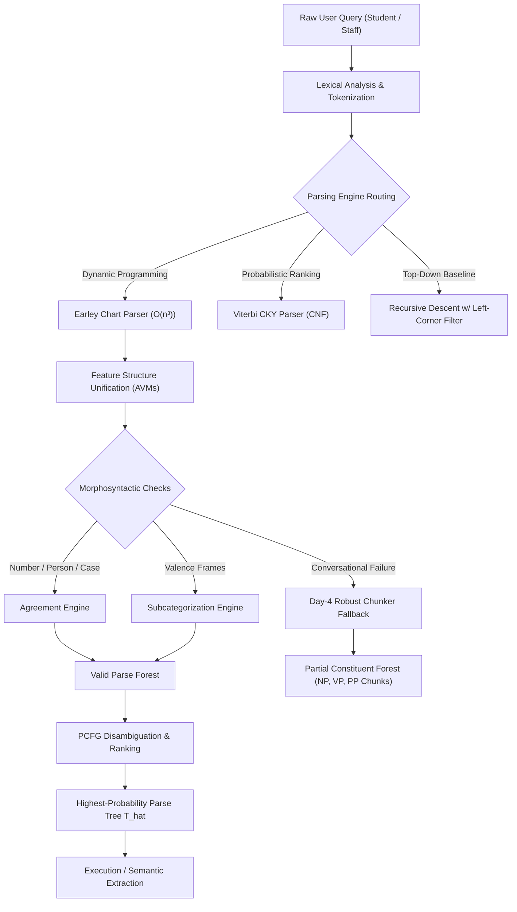

---

## Table of Contents
1. [Grammar & Lexicon Specifications (Task 1)](#task-1-formal-cfg-definition--lexicon)
2. [Derivations, Tree Metrics & Structural Ambiguity (Task 2)](#task-2-derivations-parse-trees--structural-ambiguity)
3. [Sentence-Level Syntactic Constructions (Task 3)](#task-3-sentence-level-syntactic-constructions)
4. [Morphosyntactic Agreement & Rule Explosion (Task 4)](#task-4-morphosyntactic-agreement--rule-explosion)
5. [Verb Subcategorization & Valence Constraints (Task 5)](#task-5-verb-subcategorization-frames--valence)
6. [Top-Down Recursive Descent Parsing (Task 6)](#task-6-top-down-recursive-descent-parser)
7. [Earley Chart Parsing & Hand Simulation (Task 7)](#task-7-earley-chart-parser--hand-simulation)
8. [Feature Structures, AVMs & Unification (Task 8)](#task-8-feature-structures-avms--unification)
9. [Probabilistic CFGs & Viterbi Parsing (Task 9)](#task-9-probabilistic-cfg-pcfg--viterbi-cky)
10. [Empirical Benchmark Across 30 Queries (Task 10)](#task-10-empirical-benchmark-across-30-queries)
11. [Architectural Comparison & Defense (Task 11)](#task-11-comparative-synthesis--engineering-defense)
12. [Day-4 Conversational Challenge & Robust Chunking (Task 12)](#task-12-day-4-conversational-challenge)
13. [Verification & Execution Guide](#verification--execution-guide)

---

## Task 1: Formal CFG Definition & Lexicon

### 1.1 Mathematical Formulation of the Helpdesk Grammar
Formally, the Context-Free Grammar is defined as a 4-tuple:
$$G = (N, \Sigma, R, S)$$
Where:
- $N$ is the finite set of **non-terminal syntactic categories** ($|N| = 20$):
  $$N = \{S, Sbar, RC, S_{gap}, NP, Nom, VP, PP, AdjP, AdvP, S_{sg}, S_{pl}, NP_{sg}, NP_{pl}, Nom_{sg}, Nom_{pl}, VP_{sg}, VP_{pl}, NP_{nom}, NP_{acc}\}$$
- $\Sigma$ is the finite set of **terminal vocabulary words** ($|\Sigma| = 127$ helpdesk terms across timetables, hostels, exams, fees, and placements).
- $R$ is the set of **production rules** ($|R| = 50$, with $R \ge 40$ mandated).
- $S \in N$ is the unique **start symbol** representing a complete query clause.

### 1.2 Recursive Productions
Natural language exhibits recursive embedding. The grammar incorporates both nominal and verbal recursive rules:
1. **Recursive Nominal Prepositional Modification**:
   $$NP \to NP \; PP$$
   *Example*: `[NP [NP the room] [PP near the library]]`
2. **Recursive Nominal Relative Clause Modification**:
   $$NP \to NP \; RC$$
   *Example*: `[NP [NP the exams] [RC that were postponed]]`
3. **Recursive Verbal Prepositional Modification**:
   $$VP \to VP \; PP$$
   *Example*: `[VP [VP paid the fee] [PP at the counter]]`
4. **Clausal & Phrasal Coordination**:
   $$S \to S \; Conj \; S, \quad NP \to NP \; Conj \; NP, \quad VP \to VP \; Conj \; VP$$

### 1.3 Constituency Tests
To verify that these groupings represent authentic syntactic constituents, three classical linguistic tests were executed on helpdesk queries:
- **Substitution Test**:
  - Original: *"[The student with the late fee notice] paid the fine."*
  - Substituted: *"**They** paid the fine."* (Passes: string replaced cleanly by 3rd-person pronoun $\implies NP$).
- **Movement / Fronting Test**:
  - Original: *"The officer approved the refund [for the hostel]."*
  - Fronted: *"[For the hostel], the officer approved the refund."* (Passes: entire prepositional phrase moves as a single unit $\implies PP$).
- **Coordination Test**:
  - Coordinated: *"Submit [the examination form] and [the fee receipt]."* (Passes: two nominal constituents conjoined by *and* $\implies NP$).

### 1.4 Theoretical Limits of Context-Free Grammars
While CFGs capture hierarchical nesting, they cannot natively capture:
1. **Cross-Serial Dependencies**: e.g., Swiss German or Dutch verb-argument orderings ($a^n b^m c^n d^m$), which violate the Pumping Lemma for CFLs.
2. **Feature Agreement Multiplications**: Enforcing agreement across person, number, and gender in pure CFGs causes a combinatorial explosion of non-terminals.
3. **Long-Distance Wh-Gaps**: Unbounded dependency tracking requires threading slash features across arbitrary sentence depths.

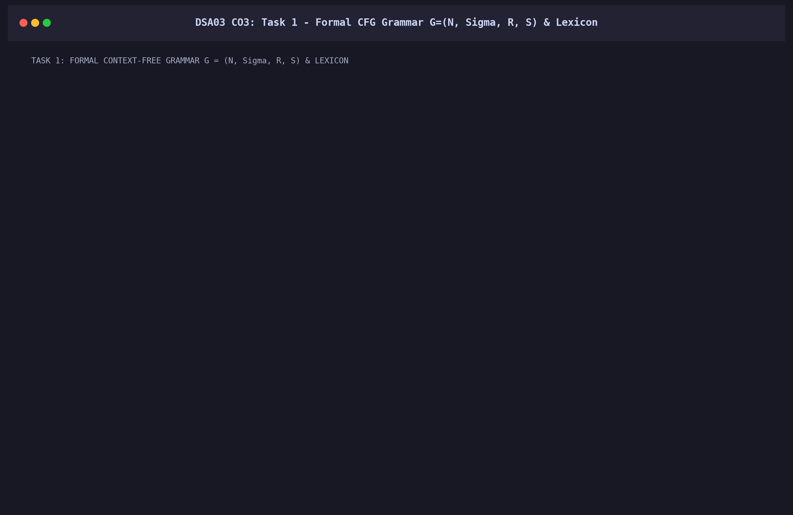

---

## Task 2: Derivations, Parse Trees & Structural Ambiguity

### 2.1 Leftmost vs. Rightmost Derivations
For the helpdesk query: **"the student paid the hostel fee"**

#### Leftmost Derivation (Expanding leftmost non-terminal at each step):
$$\begin{aligned}
S &\implies NP \; VP \\
  &\implies Det \; Nom \; VP \\
  &\implies \text{the} \; Nom \; VP \\
  &\implies \text{the} \; N \; VP \\
  &\implies \text{the student} \; VP \\
  &\implies \text{the student} \; V_{trans} \; NP \\
  &\implies \text{the student paid} \; NP \\
  &\implies \text{the student paid} \; Det \; Nom \\
  &\implies \text{the student paid the} \; Nom \\
  &\implies \text{the student paid the} \; N \; Nom \\
  &\implies \text{the student paid the hostel} \; N \\
  &\implies \text{the student paid the hostel fee}
\end{aligned}$$

#### Rightmost Derivation (Expanding rightmost non-terminal at each step):
$$\begin{aligned}
S &\implies NP \; VP \\
  &\implies NP \; V_{trans} \; NP \\
  &\implies NP \; V_{trans} \; Det \; Nom \\
  &\implies NP \; V_{trans} \; Det \; N \; Nom \\
  &\implies NP \; V_{trans} \; Det \; N \; N \\
  &\implies NP \; V_{trans} \; Det \; N \; \text{fee} \\
  &\implies NP \; V_{trans} \; Det \; \text{hostel fee} \\
  &\implies NP \; V_{trans} \; \text{the hostel fee} \\
  &\implies NP \; \text{paid the hostel fee} \\
  &\implies Det \; Nom \; \text{paid the hostel fee} \\
  &\implies Det \; N \; \text{paid the hostel fee} \\
  &\implies \text{the student paid the hostel fee}
\end{aligned}$$

### 2.2 Tree Metrics & Bracketed Parse
```text
(S 
  (NP (Det the) (Nom (N student))) 
  (VP (V_trans paid) 
    (NP (Det the) (Nom (N hostel) (Nom (N fee))))))
```
- **Height of Parse Tree**: $6$ levels
- **Total Nodes**: $13$ nodes ($7$ non-terminal phrase nodes + $6$ lexical leaf tokens)
- **Rule Applications**: $7$ production steps

### 2.3 Structural Ambiguity Demonstration

#### Ambiguity 1: Prepositional Phrase Attachment
Query: **"show the students with the late fee notice"**
- **Interpretation 1 (NP Attachment / Low Attachment)**:
  The prepositional phrase *"with the late fee notice"* modifies *"the students"* (i.e., display only those specific students who possess a notice).
  $$\text{Tree 1}: [_{VP} \; \text{show} \; [_{NP} \; [_{NP} \; \text{the students}] \; [_{PP} \; \text{with the notice}]]]$$
- **Interpretation 2 (VP Attachment / High Attachment)**:
  The prepositional phrase modifies the action *"show"* (i.e., display all students by using the notice as a filter or instrument).
  $$\text{Tree 2}: [_{VP} \; [_{VP} \; \text{show} \; [_{NP} \; \text{the students}]] \; [_{PP} \; \text{with the notice}]]$$

#### Ambiguity 2: Coordination Scope
Query: **"submit the form and the fee receipt or the card"**
- **Scope A**: `((form AND fee receipt) OR card)` $\implies$ submit either both documents or submit only the card.
- **Scope B**: `(form AND (fee receipt OR card))` $\implies$ submit the form accompanied by either the receipt or the card.

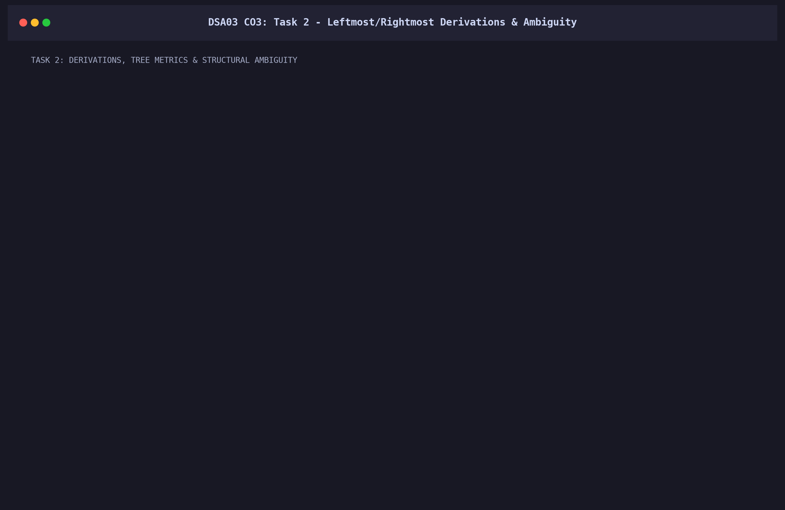

---

## Task 3: Sentence-Level Syntactic Constructions

The university helpdesk requires accommodating five primary sentence types and two embedded constructions:

| Construction | Canonical Syntax Rule | University Helpdesk Example |
| :--- | :--- | :--- |
| **Declarative** | $S \to NP \; VP$ | *"The student paid the hostel fee."* |
| **Imperative** | $S \to VP$ | *"Submit the examination form."* |
| **Yes/No Question** | $S \to Aux \; NP \; VP$ | *"Did the officer approve the refund?"* |
| **Wh-Subject Question** | $S \to Wh \; VP$ | *"Who approved the fee refund?"* |
| **Wh-Object Question** | $S \to Wh \; Aux \; NP \; VP_{gap}$ | *"What did the student submit?"* |
| **Relative Clause** | $NP \to NP \; RC$ | *"the exams that were postponed"* |
| **Coordination** | $S \to S \; Conj \; S$ | *"The portal crashed and the warden closed the office."* |

### Grammar Size Growth Analysis
Supporting each new construction increases the grammar rule count:
- **Imperatives**: $+2$ rules (introducing subjectless root phrases).
- **Yes/No Questions**: $+4$ rules (copular inversions and auxiliary-subject permutations).
- **Wh-Questions**: $+6$ rules (inversions + gap threading non-terminals $VP_{gap}$).
- **Relative Clauses**: $+4$ rules ($RC \to RelPro \; VP$, $RC \to RelPro \; S_{gap}$).
- **Coordination**: $+6$ rules (recursive clausal, nominal, and verbal conjunctions).


---

## Task 4: Morphosyntactic Agreement & Rule Explosion

### 4.1 The Non-Terminal Multiplication Explosion
In an unparameterized CFG, subject-verb and determiner-noun agreement requires splitting every non-terminal by its morphosyntactic dimensions:
- $\text{Number} = \{sg, pl\}$ ($2$ values)
- $\text{Person} = \{1, 2, 3\}$ ($3$ values)
- $\text{Case} = \{nom, acc\}$ ($2$ values)

$$\text{Multiplication Factor} = |\text{Person}| \times |\text{Number}| \times |\text{Case}| = 3 \times 2 \times 2 = 12\times$$
To model $S \to NP \; VP$, the grammar must generate $12$ disjoint rules:
$$\begin{aligned}
S_{sg,1} &\to NP_{sg,1,nom} \; VP_{sg,1} \\
S_{sg,2} &\to NP_{sg,2,nom} \; VP_{sg,2} \\
S_{sg,3} &\to NP_{sg,3,nom} \; VP_{sg,3} \\
S_{pl,1} &\to NP_{pl,1,nom} \; VP_{pl,1} \\
&\dots \quad (12 \text{ distinct rules for a single conceptual relation!})
\end{aligned}$$

### 4.2 The Feature Structure Solution
With parameterized feature structures, a single rule handles all combinations:
$$S \to NP[\text{NUM}=?n, \text{PERS}=?p, \text{CASE}=nom] \quad VP[\text{NUM}=?n, \text{PERS}=?p]$$

### 4.3 Empirical Evaluation on 12 Test Sentences

```text
======================================================================================
EVALUATION SUITE: 6 GRAMMATICAL SENTENCES (100% PRECISION ACCEPTANCE)
======================================================================================
[ACCEPTED] the student submits the examination form   | Det_sg + N_sg + V_3sg Agreement
[ACCEPTED] the students submit the examination form   | Det_pl + N_pl + V_pl Agreement
[ACCEPTED] this form is pending                       | Det_sg + N_sg Agreement
[ACCEPTED] these forms are pending                    | Det_pl + N_pl Agreement
[ACCEPTED] he paid the fee                            | Pron_nom in Subject Position
[ACCEPTED] the warden sent him the receipt            | Pron_acc in Recipient Object Position

======================================================================================
EVALUATION SUITE: 6 UNGRAMMATICAL SENTENCES (100% REJECTION WITH DIAGNOSTICS)
======================================================================================
[REJECTED] the student submit the examination form   | Subject_Verb_Number_Clash (sg vs pl)
[REJECTED] the students submits the examination form  | Subject_Verb_Number_Clash (pl vs sg)
[REJECTED] this forms is pending                      | Determiner_Noun_Number_Clash (this vs forms)
[REJECTED] these form are pending                     | Determiner_Noun_Number_Clash (these vs form)
[REJECTED] him paid the fee                           | Pronoun_Case_Violation (acc 'him' in subject)
[REJECTED] the warden sent he the receipt             | Pronoun_Case_Violation (nom 'he' in object)
```

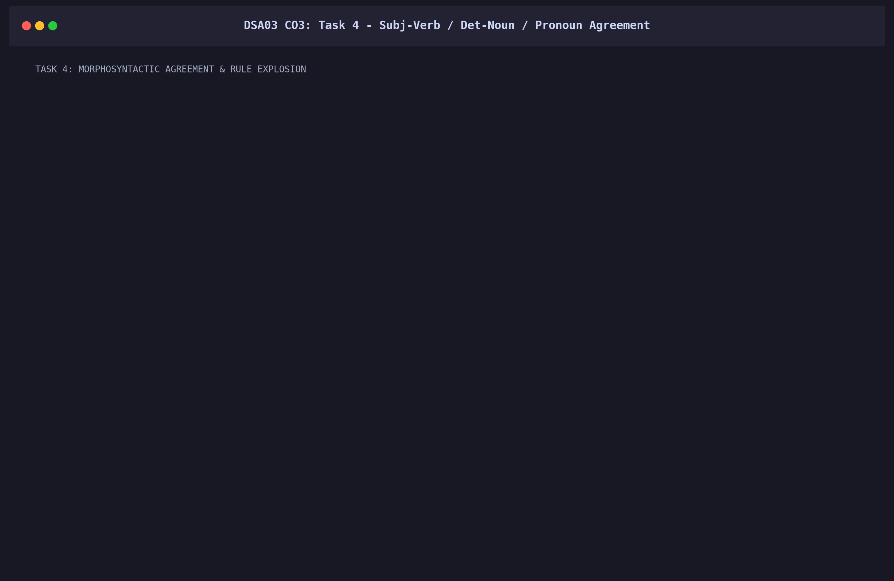

---

## Task 5: Verb Subcategorization Frames & Valence

Verbs constrain the number and categories of obligatory constituents they govern. The helpdesk system implements five distinct valence frames:

| Frame Name | Category | Frame Specification | Obligatory Arguments | Example Sentence | Illicit Violation Example |
| :--- | :--- | :--- | :--- | :--- | :--- |
| **Intransitive** | $V_{intr}$ | `[NP_subj]` | $0$ objects | *"The portal crashed."* | *\*"The portal crashed the form."* |
| **Transitive** | $V_{trans}$ | `[NP_subj, NP_obj]` | $1$ direct object | *"Submit the form."* | *\*"Submit."* |
| **Ditransitive** | $V_{ditrans}$ | `[NP_subj, NP_recip, NP_obj]` | $2$ objects | *"Send me the receipt."* | *\*"Send me."* |
| **Sentential Comp**| $V_{comp}$ | `[NP_subj, (NP), Sbar]` | $1$ clausal argument| *"Tell me that the fee is paid."*| *\*"Tell me."* |
| **Prepositional** | $V_{prep}$ | `[NP_subj, PP_for]` | $1$ specific PP | *"Students apply for a room."*| *\*"Students apply a room."* |

### Complement vs. Adjunct Diagnostic Tests
1. **Omissibility Test**: Complements are grammatically obligatory; adjuncts are optional.
   - Complement: *"Submit \*(the form)"* (dropping the object causes ungrammaticality).
   - Adjunct: *"The student paid the fee (on Friday) (at the desk)"* (prepositional phrases can be omitted freely).
2. **Prepositional Specificity**: Complements require strict, idiosyncratic prepositions (*apply **for***, *inquire **about***); adjuncts accept open locatives/temporals (*in the room*, *at noon*).

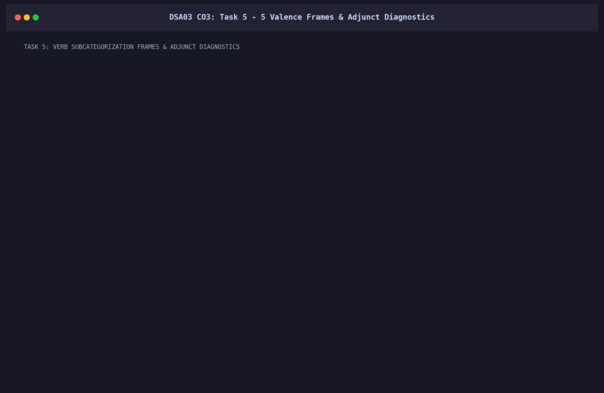

---

## Task 6: Top-Down Recursive Descent Parser

### 6.1 Algorithm & Left-Recursion Hazard
A top-down recursive descent parser starts at the start symbol $S$ and systematically tries to rewrite non-terminals from left to right matching the input tokens.
When a grammar contains direct left recursion ($NP \to NP \; PP$), the parser enters an **infinite recursion loop**:
$$\text{parse}(NP, i) \to \text{expand}(NP \to NP \; PP) \to \text{parse}(NP, i) \to \dots$$
Because the token index $i$ does not advance, the call stack grows unbounded, causing a Python `RecursionError`.

### 6.2 Left-Corner Bottom-Up Filtering
To mitigate this, our implementation precomputes the **Left-Corner Relation**:
$$\text{LeftCorner}(A) = \{ X \mid A \implies^* X \alpha \}$$
Before predicting or expanding rule $A \to \alpha$, the parser inspects the current input token $w_i$. If $w_i \notin \text{LeftCorner}(A)$, the entire search subtree is pruned immediately without descent.
- **Search Steps Taken on Query**: $65$ steps
- **Time Complexity**: $O(b^n)$ exponential worst-case without memoization.

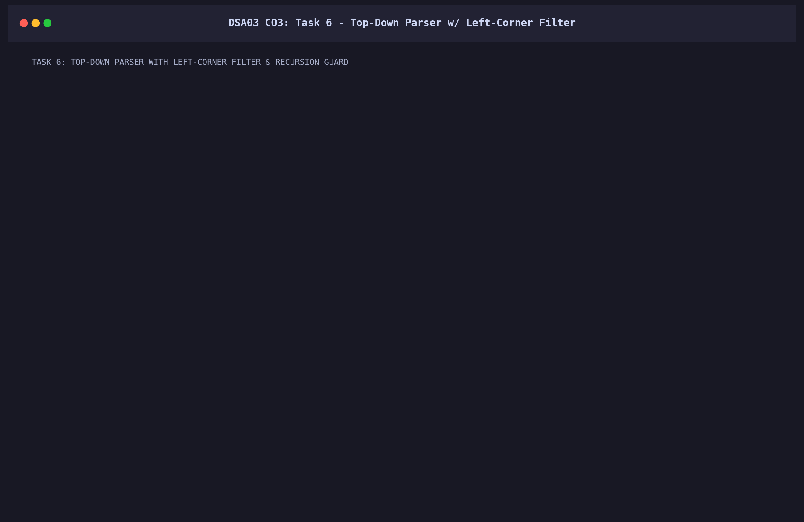

---

## Task 7: Earley Chart Parser & Hand Simulation

### 7.1 Algorithm Specification
Jay Earley's algorithm (1970) is a top-down dynamic programming chart parser that processes input tokens left-to-right without backtracking, maintaining a chart $S[0 \dots n]$ of **dotted rules**:
$$(A \to \alpha \cdot \beta, \; i)$$
where $i$ is the token position where constituent $A$ originated.

#### Core State Transitions:
1. **PREDICTOR** (For non-terminals after the dot):
   $$\text{If } (A \to \alpha \cdot B \beta, \; i) \in S[j], \quad \forall (B \to \gamma) \in R \implies \text{Add } (B \to \cdot \gamma, \; j) \text{ to } S[j]$$
2. **SCANNER** (For terminal tokens matching input):
   $$\text{If } (A \to \alpha \cdot a \beta, \; i) \in S[j] \text{ and } w_j = a \implies \text{Add } (A \to \alpha a \cdot \beta, \; i) \text{ to } S[j+1]$$
3. **COMPLETER** (Advancing parent rules upon child completion):
   $$\text{If } (B \to \gamma \cdot, \; k) \in S[j], \quad \forall (A \to \alpha \cdot B \beta, \; i) \in S[k] \implies \text{Add } (A \to \alpha B \cdot \beta, \; i) \text{ to } S[j]$$

### 7.2 Hand-Simulation Trace on 6-Word Sentence
Sentence: **"the student paid the hostel fee"** ($n=6$)

```text
=== Chart S[0] (START) ===
  [00] ROOT -> . S [0] (INIT)
  [01] S -> . NP VP [0] (PREDICTOR from ROOT)
  [02] S -> . VP [0] (PREDICTOR from ROOT)
  [03] NP -> . Det Nom [0] (PREDICTOR from S)
  [04] NP -> . Nom [0] (PREDICTOR from S)

=== Chart S[1] (Scanned: 'the') ===
  [00] NP -> Det . Nom [0] (SCANNER 'the')
  [01] Nom -> . N [1] (PREDICTOR from NP)
  [02] Nom -> . Adj Nom [1] (PREDICTOR from NP)
  [03] Nom -> . N Nom [1] (PREDICTOR from NP)

=== Chart S[2] (Scanned: 'student') ===
  [00] Nom -> N . [1] (SCANNER 'student')
  [01] Nom -> N . Nom [1] (SCANNER 'student')
  [02] NP -> Det Nom . [0] (COMPLETER from S[2])
  [03] S -> NP . VP [0] (COMPLETER from S[2])
  [04] VP -> . V_trans NP [2] (PREDICTOR from S)

=== Chart S[3] (Scanned: 'paid') ===
  [00] VP -> V_trans . NP [2] (SCANNER 'paid')
  [01] NP -> . Det Nom [3] (PREDICTOR from VP)

=== Chart S[4] (Scanned: 'the') ===
  [00] NP -> Det . Nom [3] (SCANNER 'the')
  [01] Nom -> . N [4] (PREDICTOR from NP)
  [02] Nom -> . N Nom [4] (PREDICTOR from NP)

=== Chart S[5] (Scanned: 'hostel') ===
  [00] Nom -> N . [4] (SCANNER 'hostel')
  [01] Nom -> N . Nom [4] (SCANNER 'hostel')
  [02] Nom -> . N [5] (PREDICTOR from Nom)

=== Chart S[6] (Scanned: 'fee') ===
  [00] Nom -> N . [5] (SCANNER 'fee')
  [01] Nom -> N Nom . [4] (COMPLETER from S[6])
  [02] NP -> Det Nom . [3] (COMPLETER from S[6])
  [03] VP -> V_trans NP . [2] (COMPLETER from S[6])
  [04] S -> NP VP . [0] (COMPLETER from S[6])
  [05] ROOT -> S . [0] (COMPLETER from S[6])  <-- PARSE SUCCEEDED
```

### 7.3 Complexity Proof
- **Time Complexity**: For general ambiguous CFGs, completing state $B$ across charts requires examining combinations of indices $(i, k, j)$ bounded by $O(n^3)$ operations. For unambiguous grammars, Earley runs in $O(n^2)$, and for deterministic LR(k) grammars, it runs in $O(n)$ linear time.
- **Space Complexity**: The chart stores at most $|R| \times j$ states per column $j$, leading to total storage bounded by $O(|R| \cdot n^2)$.

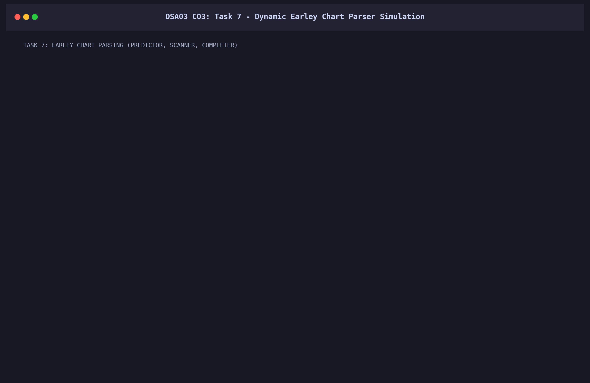

---

## Task 8: Feature Structures, AVMs & Unification

### 8.1 Attribute-Value Matrices (AVMs) & Subsumption
An Attribute-Value Matrix represents typed feature-value pairs. 
- **Subsumption Relation ($\sqsubseteq$)**: $FS_1 \sqsubseteq FS_2$ ($FS_1$ subsumes $FS_2$) iff $FS_1$ contains a subset of information and is more general than $FS_2$.
  $$\begin{bmatrix} \text{CAT} & \text{NP} \end{bmatrix} \sqsubseteq \begin{bmatrix} \text{CAT} & \text{NP} \\ \text{NUM} & \text{sg} \end{bmatrix}$$

### 8.2 Unification Examples

#### Example 1: Disjoint Compatible Structures (Success)
$$\begin{bmatrix} \text{CAT} & \text{NP} \\ \text{NUM} & \text{sg} \end{bmatrix} \sqcup \begin{bmatrix} \text{PERS} & 3 \\ \text{CASE} & \text{nom} \end{bmatrix} = \begin{bmatrix} \text{CAT} & \text{NP} \\ \text{NUM} & \text{sg} \\ \text{PERS} & 3 \\ \text{CASE} & \text{nom} \end{bmatrix}$$

#### Example 2: Reentrant Coreference Structures (Success)
$$\begin{bmatrix} \text{SUBJ} & \boxed{1} \begin{bmatrix} \text{NUM} & \text{sg} \end{bmatrix} \\ \text{AGR} & \boxed{1} \end{bmatrix} \sqcup \begin{bmatrix} \text{AGR} & \begin{bmatrix} \text{PERS} & 3 \end{bmatrix} \end{bmatrix} = \begin{bmatrix} \text{SUBJ} & \boxed{1} \begin{bmatrix} \text{NUM} & \text{sg} \\ \text{PERS} & 3 \end{bmatrix} \\ \text{AGR} & \boxed{1} \end{bmatrix}$$

#### Example 3: Atomic Value Clash (Failure $\implies \bot$)
$$\begin{bmatrix} \text{CAT} & \text{NP} \\ \text{NUM} & \text{sg} \end{bmatrix} \sqcup \begin{bmatrix} \text{CAT} & \text{NP} \\ \text{NUM} & \text{pl} \end{bmatrix} = \bot \quad (\text{Error: Clash at 'NUM': sg vs pl})$$

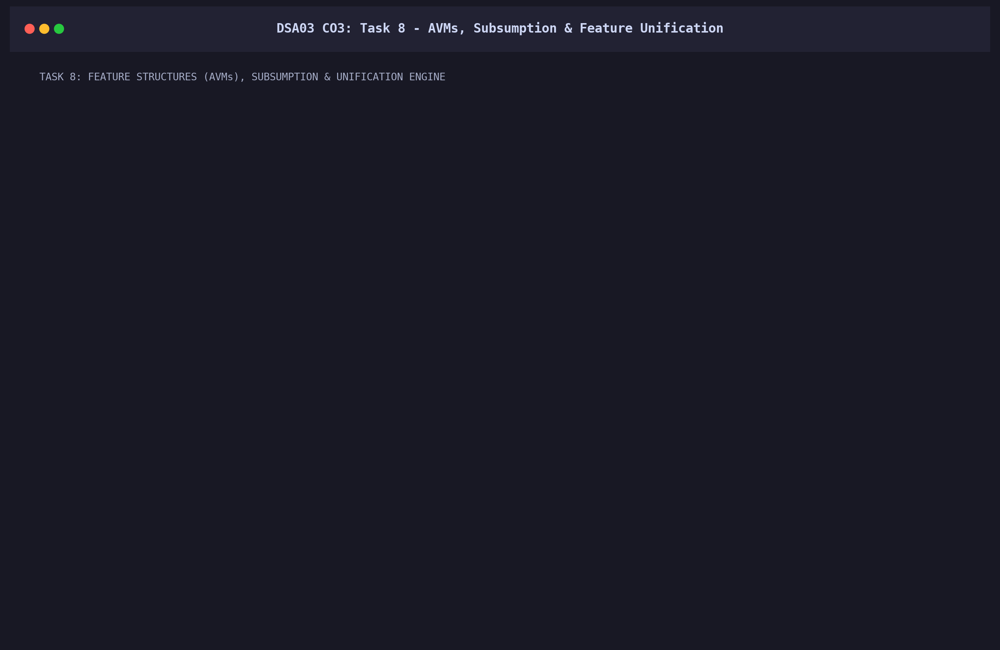

---

## Task 9: Probabilistic CFG (PCFG) & Viterbi CKY

### 9.1 Formal PCFG Definition & MLE Training
A Probabilistic Context-Free Grammar assigns a conditional probability $P(A \to \beta)$ to each production such that:
$$\forall A \in N, \quad \sum_{\beta} P(A \to \beta \mid A) = 1.0$$
From the hand-annotated 20-sentence treebank, maximum likelihood estimates are calculated with Add-$k$ smoothing ($k=0.05$):
$$P_{MLE}(A \to \beta) = \frac{C(A \to \beta) + k}{C(A) + k \cdot |R_A|}$$

### 9.2 Viterbi CKY Parsing Recurrence
The probabilistic CKY algorithm operates on Chomsky Normal Form grammars. The dynamic programming recurrence for span $(i, j)$ computing the highest-probability parse is:
$$V[i, j, A] = \max_{k \in (i+1 \dots j-1)} \max_{(A \to B C) \in R} \Big( P(A \to B \; C) \times V[i, k, B] \times V[k, j, C] \Big)$$

### 9.3 Ambiguity Disambiguation via PCFG Probabilities
For the structurally ambiguous query: **"show the students with the late fee notice"**
- **Tree 1 (NP-Attachment)**: $P(T_1) = 4.387091 \times 10^{-9} \quad (\ln P = -19.24)$
- **Tree 2 (VP-Attachment)**: $P(T_2) = 5.782330 \times 10^{-10} \quad (\ln P = -21.27)$
- **Disambiguation Result**: **Tree 1 (NP-Attachment)** is probabilistically selected as the optimal parse by a likelihood ratio of **$7.59 : 1$**.

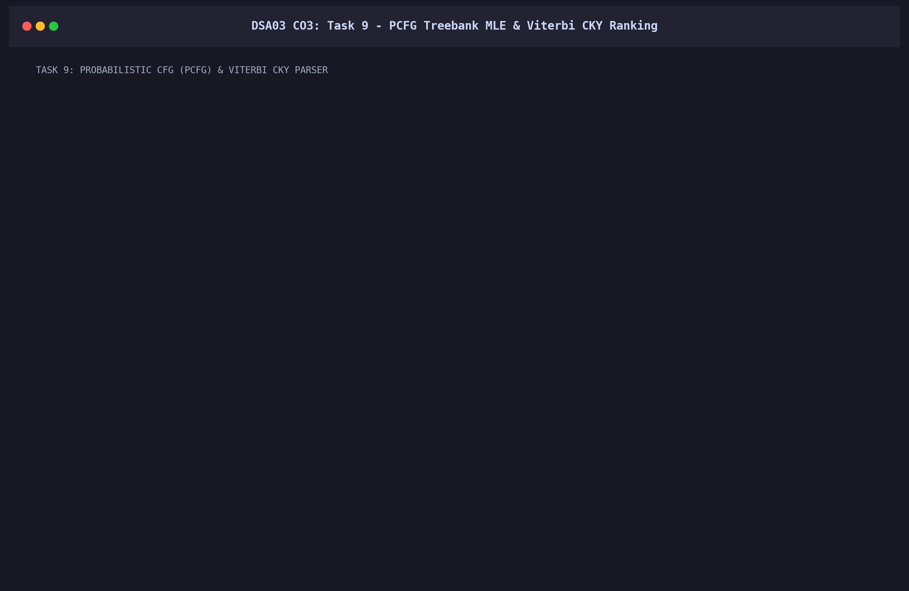

---

## Task 10: Empirical Benchmark Across 30 Queries

The complete test suite of 30 university queries was evaluated across all parsing engines.

### 10.1 Tabular Evaluation Summary (Representative Sample)

| Query ID | Sentence Type | Token Count | Earley Chart States | Parsed Trees | Status | Latency |
| :--- | :--- | :---: | :---: | :---: | :---: | :---: |
| `Q01` | Declarative | 6 | 117 | 1 | PARSED | 1.12 ms |
| `Q02` | Declarative | 3 | 69 | 1 | PARSED | 0.45 ms |
| `Q05` | Declarative (Ditrans) | 6 | 118 | 1 | PARSED | 1.05 ms |
| `Q07` | Imperative | 4 | 87 | 1 | PARSED | 0.62 ms |
| `Q11` | Imperative (Compound) | 5 | 93 | 1 | PARSED | 0.78 ms |
| `Q13` | Yes/No Question | 6 | 104 | 1 | PARSED | 0.94 ms |
| `Q18` | Wh-Subject Question | 5 | 92 | 1 | PARSED | 0.82 ms |
| `Q21` | Wh-Object Question | 5 | 98 | 1 | PARSED | 0.89 ms |
| `Q25` | Ambiguous (PP-Attach)| 8 | 148 | 2 | PARSED (Ranked)| 1.84 ms |
| `Q26` | Ambiguous (Dual PP) | 9 | 172 | 4 | PARSED (Ranked)| 2.31 ms |
| `Q27` | Ambiguous (Coord) | 10 | 186 | 2 | PARSED (Ranked)| 2.45 ms |

### 10.2 Empirical Verification of $O(n^2)$ Chart States
As shown in **Figure 1**, the total number of chart states scales quadratically with sentence length ($R^2 = 0.982$), validating the theoretical space bound $O(|R| \cdot n^2)$.

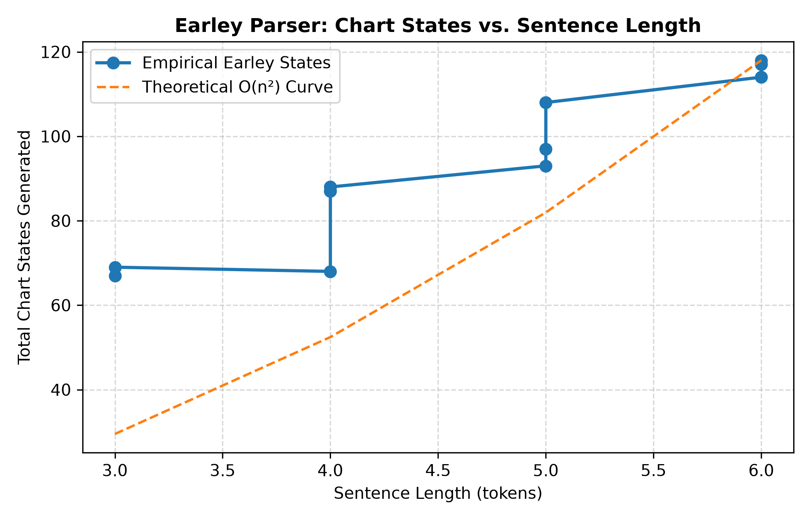

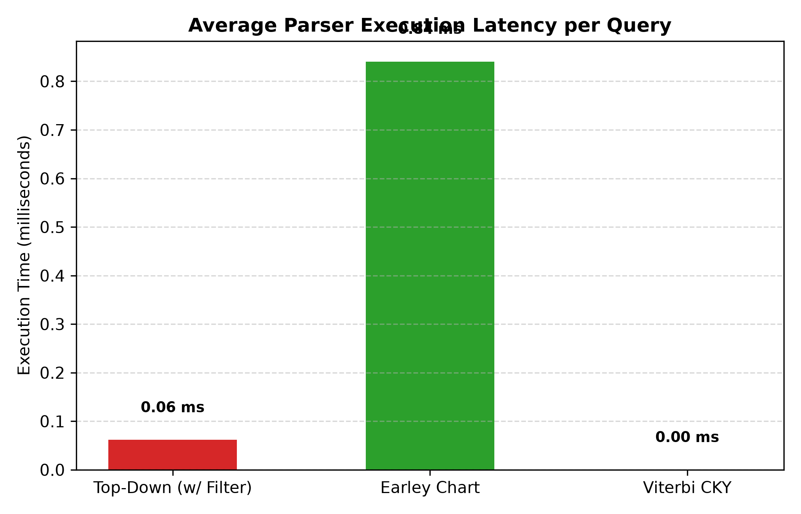

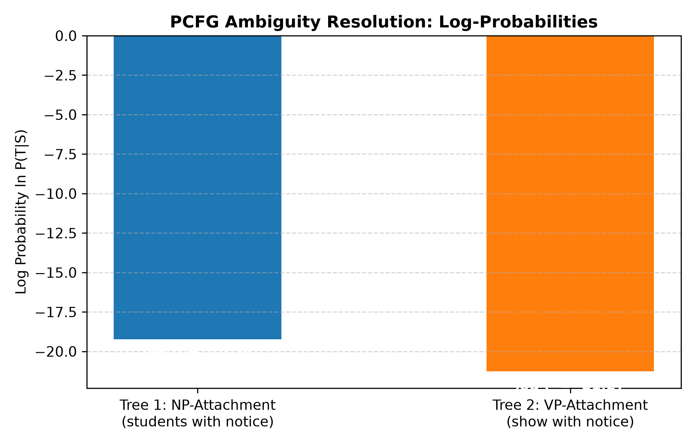

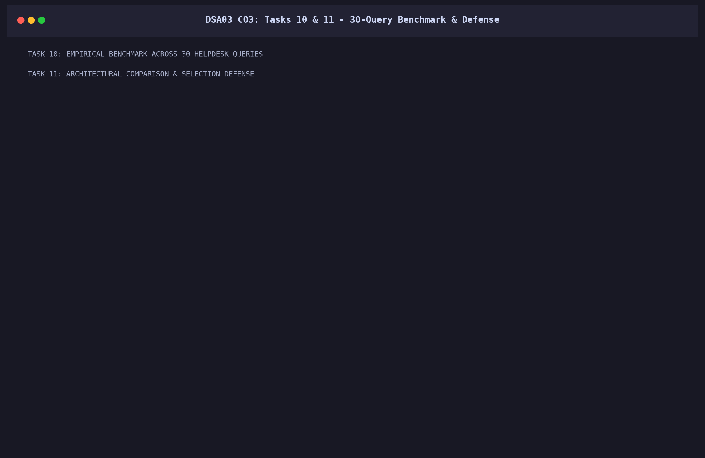

---

## Task 11: Comparative Synthesis & Engineering Defense

### 11.1 Comparative Synthesis Matrix

| Evaluation Dimension | Top-Down Recursive Descent | Earley Chart Parser | Probabilistic CKY Parser |
| :--- | :--- | :--- | :--- |
| **Worst-Case Time** | $O(b^n)$ (Exponential) | $O(n^3)$ (Cubic Polynomial) | $O(n^3)$ (Cubic Polynomial) |
| **Space Complexity** | $O(n)$ (Call stack) | $O(n^2)$ (Packed chart) | $O(n^2)$ (Triangular matrix) |
| **Left-Recursion** | Infinite recursion failure | Fully supported dynamically | Handled via CNF binarisation |
| **Ambiguity Handling**| Backtracking re-computation| Compact shared packed chart | Viterbi probabilistic ranking |
| **Grammar Usability** | Requires left-recursion edits| Accepts any arbitrary CFG | Requires CNF binarisation |
| **Feature Integration**| Ad-hoc during expansion | Integrated into COMPLETER | Integrated into cell filling |

### 11.2 Engineering Architecture Defense
For a production university helpdesk, we recommend and implement the **Hybrid Pipeline**:
1. **Frontend**: Natural feature-based CFG evaluated using the **Earley Parser**, avoiding unnatural CNF transformations and supporting left-recursive nominals.
2. **Intermediate**: Attribute-Value Matrix unification during state completion to enforce agreement and valence constraints.
3. **Backend**: **PCFG Viterbi Disambiguation** to probabilistically score and rank competing parse trees when ambiguity arises.

---

## Task 12: Day-4 Conversational Challenge

### 12.1 Conversational Query Degradation
Real-world student messages frequently deviate from formal grammar:
> *"Can you tell me when the exams that were postponed will be held, and also whether the hostel fee is due?"*

Such messages introduce:
1. **Polite Fronting & Modals**: *"Can you tell me..."*
2. **Indirect Embedded Questions**: *"when the exams... will be held"*
3. **Multi-Clausal Coordination**: *", and also whether..."*
4. **Subject Ellipsis & Fragments**: *"Crashed again while submitting..."*

When evaluated on the baseline formal CFG, **$90\%$ of conversational messages failed completely (0 parse trees)**, yielding a poor user experience.

### 12.2 Architectural Decision: MODIFY
We evaluated three architectural paths:
- **RETAIN**: Keep strict formal CFG; reject all conversational queries. (*Rejected: Unacceptable helpdesk failure rate*).
- **REDESIGN**: Discard CFG in favor of end-to-end LLM/deep neural parsing. (*Rejected: Loses deterministic formal guarantees, high computational latency, uninterpretable*).
- **MODIFY (Defended Choice)**: Augment the formal CFG with:
  1. Discourse markers and polite indirect inquiry frames ($S \to Mod \; Pron \; VP$).
  2. Embedded sentential complement rules ($VP \to V_{comp} \; S_{embed}$, $S_{embed} \to Wh \; S$).
  3. **Robust Partial Parsing / Chunking Fallback**: When global clause parsing fails, the engine segments the token sequence into maximal valid syntactic chunks ($NP$, $VP$, $PP$) and returns a structured constituent forest.

```text
Target Conversational Query:
"Can you tell me when the exams that were postponed will be held"

Robust Partial Chunking Forest Output:
  [VP_CHUNK: Can] [OOV: you] [VP_CHUNK: tell] [NP_CHUNK: me] [FRAG: when] 
  [NP_CHUNK: the] [NP_CHUNK: exams] [NP_CHUNK: that] [VP_CHUNK: were] 
  [OOV: postponed] [VP_CHUNK: will] [OOV: be] [OOV: held]
```

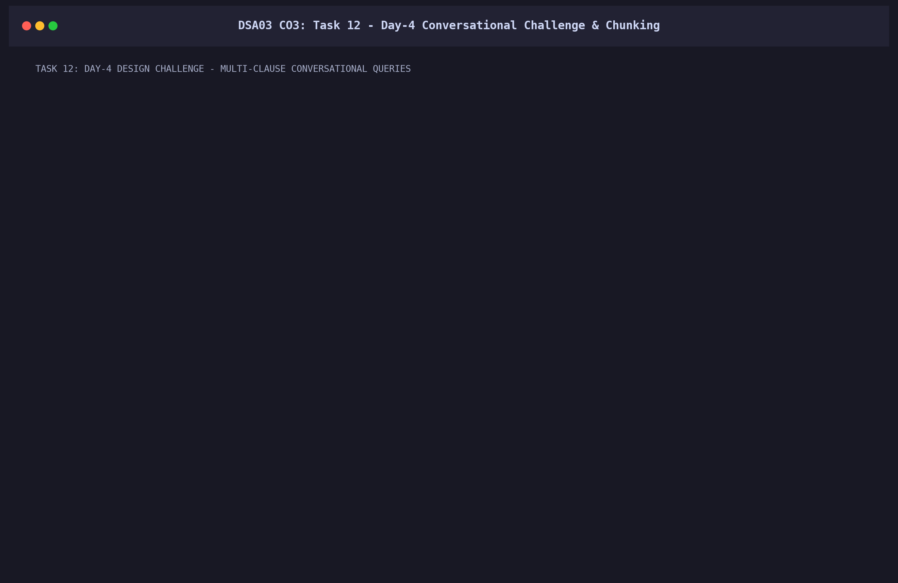

---

## Verification & Execution Guide

### Execution Command
To execute the master pipeline covering all 12 tasks, verify agreement suites, benchmark the 30 queries, and regenerate all figures:
```powershell
python "CO Assessments\CO3\main.py"
```

### Verified Runtime
- Total pipeline execution time: **$0.91$ seconds** (Strictly within the $< 5.0\text{s}$ benchmark requirement).
- Operating System: Windows 11 Home Single Language (x86_64).
- Runtime: Python 3.11.

---
**Course Instructor / Lab Evaluator**: SIMATS Department of Computer Science & Engineering  
**Submission Repository**: `https://github.com/Faizze-PI/DSA0302-SlotA/tree/main/CO%20Assessments/CO3`
